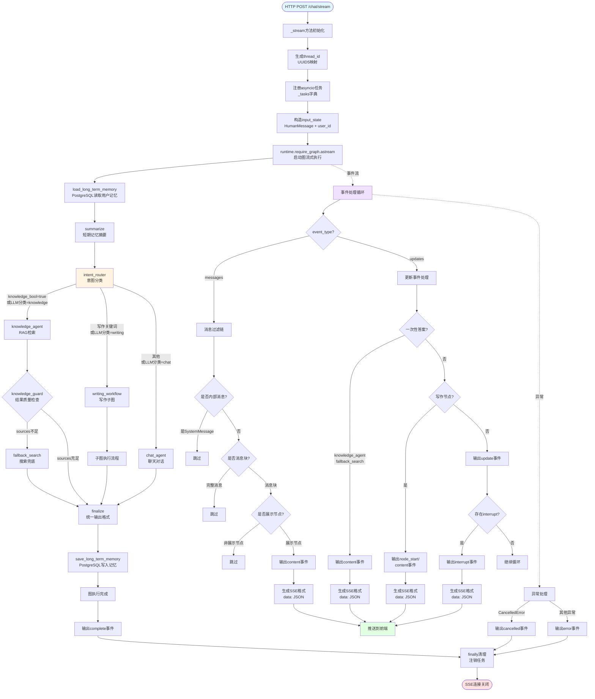
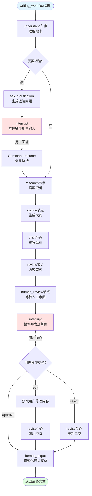
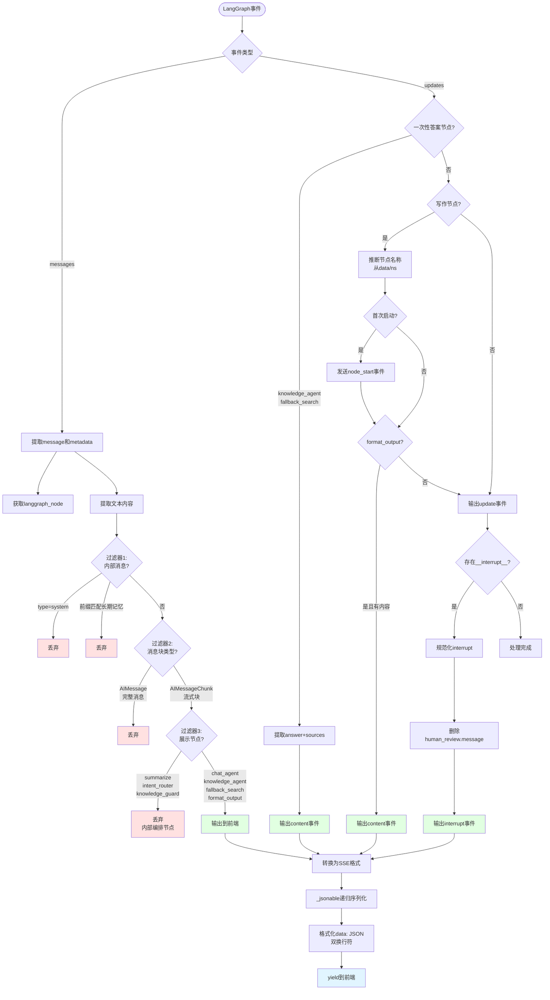
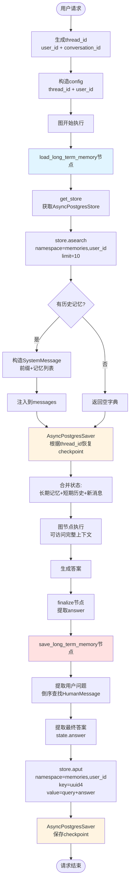

# `_stream` 方法全链路业务逻辑拆解

## 一、主干剖析

### 1.1 核心职责
`_stream` 方法是 **LangGraph 流式聊天的核心编排层**，负责：
- 将用户的 HTTP 聊天请求转换为 LangGraph 图的输入状态
- 管理异步任务的生命周期（注册/注销）
- 实时监听图执行过程中产生的事件流（messages/updates）
- 将 LangGraph 内部事件转换为前端约定的 SSE（Server-Sent Events）格式
- 过滤内部消息，只向前端暴露用户可见的内容

### 1.2 输入输出
**输入参数：**
- `request: ChatRequest` - 包含 user_id、conversation_id、message、knowledge_bool
- `run_id: str` - 本次执行的唯一标识符

**输出：**
- `AsyncIterator[str]` - SSE 格式的事件流，每个事件为 `data: {json}\n\n` 格式

### 1.3 架构定位
- **所在层级：** API 层（FastAPI 路由处理函数）
- **上游：** `/chat/stream` 端点（FastAPI StreamingResponse）
- **下游：** LangGraph 图运行时（`runtime.require_graph().astream()`）
- **作用：** 作为业务协议适配层，将 LangGraph 的通用图执行协议转换为项目特定的前端 SSE 协议

---

## 二、业务流程图

### 2.1 整体架构流程图



### 2.2 写作子图详细流程



### 2.3 事件过滤机制流程



### 2.4 长短期记忆交互流程



### 2.5 任务生命周期管理流程

```mermaid
graph TB
    Request([HTTP请求到达]) --> StreamFunc[_stream函数启动]
    StreamFunc --> GenRunID[生成run_id<br/>uuid4]
    GenRunID --> GetTask[asyncio.current_task<br/>获取当前任务]
    
    GetTask --> Register[注册到_tasks字典<br/>key=thread_id,run_id<br/>value=Task对象]
    Register --> Try[try块开始]
    
    Try --> Yield1[yield conversation_id事件]
    Yield1 --> Yield2[yield start事件]
    Yield2 --> StreamLoop[astream事件循环]
    
    StreamLoop --> Process[处理并yield事件]
    Process --> MoreEvents{还有事件?}
    MoreEvents -->|是| Process
    MoreEvents -->|否| YieldComplete[yield complete事件]
    
    YieldComplete --> Finally[finally块]
    
    StreamLoop -.用户取消.-> CancelAPI[/chat/cancel接口]
    CancelAPI --> LookupTask[从_tasks查找<br/>thread_id,run_id]
    LookupTask --> FoundTask{找到任务?}
    FoundTask -->|是| CallCancel[task.cancel]
    CallCancel --> RaiseCancelled[抛出CancelledError]
    FoundTask -->|否| NoOp[无操作<br/>可能在其他worker]
    
    RaiseCancelled --> ExceptCancel[except CancelledError]
    ExceptCancel --> YieldCancel[yield cancelled事件]
    YieldCancel --> ReRaise[重新抛出异常]
    ReRaise --> Finally
    
    StreamLoop -.图执行异常.-> ExceptError[except Exception]
    ExceptError --> YieldError[yield error事件]
    YieldError --> Finally
    
    Finally --> Unregister[从_tasks注销<br/>pop thread_id,run_id]
    Unregister --> End([SSE连接关闭])
    
    style Register fill:#e1f5ff
    style Unregister fill:#ffe1e1
    style CancelAPI fill:#fff4e1
    style ExceptCancel fill:#ffe1e1
    style ExceptError fill:#ffe1e1
```

---

## 三、逐层深挖（调用树）

### **1. 前置准备阶段**

#### 1.1 线程ID映射
```python
thread_id = _thread_id(request.user_id, request.conversation_id)
```

**调用链：** `_stream` → `_thread_id()`

**`_thread_id` 方法逻辑：**
- **职责：** 将业务身份（user_id + conversation_id）稳定映射为 PostgreSQL checkpointer 的 thread_id
- **实现：** 使用 UUID5（确定性哈希）生成：`uuid5(NAMESPACE_URL, f"custom-langgraph:{user_id}:{conversation}")`
- **技术要点：**
  - **幂等性设计：** 相同输入始终产生相同 UUID，确保服务重启后能恢复同一会话
  - **命名空间隔离：** 将 user_id 和 conversation_id 都纳入哈希，避免不同用户的同名会话串线
  - **默认会话处理：** conversation_id 为空时使用 "default"

**数据流转：**
```
输入: user_id="user123", conversation_id="conv456"
输出: thread_id="a1b2c3d4-..."（确定性UUID）
```

---

#### 1.2 任务注册
```python
task = asyncio.current_task()
if task is not None:
    _tasks[(thread_id, run_id)] = task
```

**调用链：** `_stream` → 全局 `_tasks` 字典

**业务逻辑：**
- **职责：** 将当前 asyncio 任务注册到全局任务字典，供取消接口调用
- **数据结构：** `_tasks: dict[tuple[str, str], asyncio.Task]`，键为 `(thread_id, run_id)`
- **技术要点：**
  - **单 worker 限制：** 任务只存在当前进程内存，多 worker 部署下取消接口只能取消同一 worker 的任务
  - **生命周期管理：** 任务完成或异常时，必须从字典中注销（finally 块）

---

#### 1.3 输入状态构造
```python
input_state: dict[str, Any] = {
    "messages": [HumanMessage(content=request.message)],
    "user_id": request.user_id,
}
if request.knowledge_bool is not None:
    input_state["knowledge_bool"] = request.knowledge_bool
```

**调用链：** `_stream` → LangChain `HumanMessage` 对象构造

**业务逻辑：**
- **职责：** 将 HTTP 请求转换为 LangGraph 图状态格式
- **技术要点：**
  - **增量状态设计：** 只传入本轮新增消息，历史由 checkpointer 自动恢复
  - **显式知识库开关：** `knowledge_bool` 可覆盖 LLM 的意图分类结果
  - **LangChain 消息对象：** 使用 `HumanMessage` 确保类型一致性

---

### **2. 核心流式处理阶段**

#### 2.1 启动图流式执行
```python
async for part in runtime.require_graph().astream(
    input_state,
    config=_config(request.user_id, thread_id),
    stream_mode=["messages", "updates"],
    subgraphs=True,
    version="v2",
):
```

**调用链：** `_stream` → `runtime.require_graph()` → `PostgresGraphRuntime.require_graph()` → LangGraph `astream()`

---

##### 2.1.1 `runtime.require_graph()` 解析

**调用链：** `_stream` → `runtime.require_graph()`

**源码位置：** `graph_runtime.py:254-258`

**业务逻辑：**
```python
def require_graph(self) -> Any:
    if self.graph is None:
        raise RuntimeError("PostgreSQL graph runtime has not started")
    return self.graph
```

- **职责：** 返回已编译的 LangGraph 图实例，未启动时抛出异常
- **graph 来源：** 在 `startup()` 方法中通过以下步骤构建：

**深度调用链：** `runtime.startup()` → `build_graph_builder()` → `StateGraph.compile()`

---

##### 2.1.2 图构建过程（`build_graph_builder`）

**调用链：** `runtime.startup()` → `build_graph_builder()` → `StateGraph.compile(checkpointer, store)`

**源码位置：** `graph_runtime.py:143-192`

**拓扑结构：**
```
START 
  → load_long_term_memory       # 加载用户长期记忆
  → summarize                    # 短期记忆摘要
  → intent_router                # 意图路由（knowledge/writing/chat）
  ├─→ knowledge_agent            # 知识库检索
  │   └─→ knowledge_guard        # 结果守卫
  │       ├─→ fallback_search    # 兜底搜索
  │       └─→ finalize
  ├─→ writing_workflow           # 写作子图
  │   └─→ finalize
  └─→ chat_agent                 # 聊天Agent
      └─→ finalize
        → save_long_term_memory  # 保存长期记忆
        → END
```

---

##### 2.1.3 核心节点详解

###### **A. load_long_term_memory 节点**

**调用链：** 图执行 → `load_long_term_memory(state)` → `AsyncPostgresStore.asearch()`

**源码位置：** `graph_runtime.py:43-89`

**业务逻辑：**
1. 从图状态提取 `user_id`
2. 调用 `get_store()` 获取 `AsyncPostgresStore` 实例（由 compile 时注入）
3. 执行 `store.asearch(("memories", user_id), limit=10)`
   - **原子操作：** PostgreSQL SELECT 查询，读取 `namespace=('memories', user_id)` 的前10条记忆
4. 将查询结果转换为 `SystemMessage`，格式为：
   ```
   以下是该用户的长期记忆，仅在与当前问题相关时参考：
   用户曾问：xxx
   助手曾答：yyy
   ```
5. 返回 `{"messages": [SystemMessage(...)]}`，LangGraph 合并到图状态

**技术要点：**
- **命名空间隔离：** 使用 `(memories, user_id)` 确保不同用户数据隔离
- **跨会话共享：** 同一用户的不同 thread 共享长期记忆
- **状态增量更新：** 返回的字典会被 LangGraph 合并到现有状态

---

###### **B. summarize 节点**

**调用链：** 图执行 → `summarization_node(state)` → `SummarizationNode.__call__()` → LLM.ainvoke()

**源码位置：** `nodes.py:46-52`

**业务逻辑：**
- **核心库：** `langmem.short_term.SummarizationNode`（官方短期记忆摘要组件）
- **触发条件：** 当消息 token 数超过 `max_tokens_before_summary=2048` 时
- **执行流程：**
  1. 调用 `token_counter()` 统计消息总 token 数
  2. 若超过阈值，调用 LLM 将旧消息压缩为 running summary（限制 512 tokens）
  3. 返回 `{"summarized_messages": [摘要消息 + 最近原始消息]}`
- **下游使用：** 后续节点通过 `get_model_messages(state)` 优先使用 `summarized_messages`

**技术要点：**
- **性能优化：** 减少长对话的 token 消耗
- **绑定小模型：** 使用 `max_tokens=512` 避免摘要本身过长

---

###### **C. intent_router 节点**

**调用链：** 图执行 → `intent_router(state)` → `get_llm().ainvoke()` → OpenAI API

**源码位置：** `nodes.py:102-141`

**业务逻辑：**
1. **显式开关优先：** 检查 `state.knowledge_bool`
   - `True` → 直接返回 `{"intent": "knowledge"}`
   - `False` → 快速模式匹配，写作关键词进入 writing，其余进入 chat
2. **LLM 分类：** 若无显式开关
   - 调用 `get_latest_user_query(state)` 提取最新用户消息
   - 构造分类 prompt，调用 `ChatOpenAI.ainvoke()`
   - **原子操作：** HTTP POST 请求到 OpenAI API（或兼容端点）
   - 解析响应：`knowledge` / `writing` / `chat`
3. 返回 `{"intent": "..."}`

**技术要点：**
- **快速路径优化：** 显式开关 + 关键词匹配，减少 LLM 调用
- **倒序查找用户消息：** 避免误取历史消息或 AI 回复

---

###### **D. knowledge_agent / chat_agent / writing_workflow**

这三个节点根据 `intent_router` 的结果被条件路由触发。

**D1. knowledge_agent**

**调用链：** 图执行 → `knowledge_agent(state)` → `call_mcp_tool("rag-db", ...)` → MCP服务 HTTP请求

**业务逻辑：**
- 调用 RAG 检索工具（通过 MCP 协议）
- 使用检索结果构造 prompt，调用 LLM 生成答案
- **原子操作：** HTTP POST 到 MCP 服务的 RAG 端点，执行向量检索（可能涉及 Embedding + 向量数据库查询）
- 返回 `{"answer": "...", "sources": [...]}`

**D2. chat_agent**

**调用链：** 图执行 → `chat_agent(state)` → `ChatOpenAI.astream()` → OpenAI API

**业务逻辑：**
- 直接调用 LLM 进行多轮对话
- **流式输出：** 使用 `astream()` 产生 `AIMessageChunk`
- **原子操作：** HTTP POST 到 OpenAI API（stream=true），接收 SSE 响应
- 返回 `{"messages": [AIMessage(...)]}`

**D3. writing_workflow（写作子图）**

**调用链：** 图执行 → `call_writing_subgraph(state)` → 子图执行（包含多个写作节点）

**子图拓扑：**
```
understand → ask_clarification（interrupt）→ research → outline → draft 
→ review → human_review（interrupt）→ revise → format_output
```

**技术要点：**
- **子图封装：** 通过 `call_writing_subgraph` 包装函数调用，父图只接收最终结果
- **人工中断（interrupt）：** `ask_clarification` 和 `human_review` 节点会暂停图执行，等待用户输入
- **多节点协作：** 理解需求 → 搜索资料 → 生成大纲 → 撰写草稿 → 审核 → 人工审阅 → 修订 → 格式化

---

###### **E. finalize 节点**

**调用链：** 图执行 → `finalize(state)`

**业务逻辑：**
- 将内部状态统一整理为 `answer`、`sources`、`intent` 字段
- 从 messages 中提取最终 AI 回复
- 返回 `{"answer": "...", "sources": [...]}`

---

###### **F. save_long_term_memory 节点**

**调用链：** 图执行 → `save_long_term_memory(state)` → `AsyncPostgresStore.aput()`

**源码位置：** `graph_runtime.py:92-140`

**业务逻辑：**
1. 提取本轮用户问题（倒序查找最近的 HumanMessage）
2. 提取最终答案（从 `state.answer`）
3. 调用 `store.aput(("memories", user_id), uuid4(), {...})`
   - **原子操作：** PostgreSQL INSERT，写入 `namespace=('memories', user_id)` 的新记忆
4. 返回空字典（无状态更新）

**技术要点：**
- **随机 key：** 使用 UUID 作为 key，避免覆盖历史记忆
- **不启用索引：** `index=False`，避免普通对话文本被误当成向量检索数据

---

##### 2.1.4 `_config()` 配置构造

**调用链：** `_stream` → `_config(user_id, thread_id)`

**源码位置：** `chat.py:94-105`

**业务逻辑：**
```python
def _config(user_id: str, thread_id: str) -> dict[str, Any]:
    return {
        "configurable": {
            "thread_id": thread_id,         # 短期会话恢复
            "user_id": user_id,             # 长期记忆命名空间
            "langgraph_user_id": user_id,   # LangGraph 内置用户隔离
        }
    }
```

**技术要点：**
- `thread_id` 供 AsyncPostgresSaver 恢复当前会话的 checkpoint
- `user_id` 供长期记忆节点选择 namespace
- 两者必须同时传入，确保短期/长期数据边界正确

---

##### 2.1.5 `astream()` 参数解析

**参数说明：**
- `input_state`: 图的输入状态（增量消息）
- `config`: 包含 thread_id、user_id 的配置字典
- `stream_mode=["messages", "updates"]`: 订阅两类事件
  - **messages**: 流式消息块（AIMessageChunk）
  - **updates**: 节点状态更新（包含 interrupt、节点结果）
- `subgraphs=True`: 包含子图事件（写作子图的节点事件也会被捕获）
- `version="v2"`: 使用 LangGraph v2 事件格式

---

#### 2.2 事件处理循环

**核心逻辑：**
```python
async for part in runtime.require_graph().astream(...):
    if not isinstance(part, dict):
        continue
    event_type = part.get("type")
    data = part.get("data")
```

**事件类型解析：**

---

##### 2.2.1 messages 事件处理

**调用链：** 事件循环 → `_message_and_metadata()` → `_message_text()` → `_is_internal_message()` → `_is_message_chunk()` → `_event()`

**完整流程：**

```python
if event_type == "messages":
    message, metadata = _message_and_metadata(data)
    node_name = str(metadata.get("langgraph_node", ""))
    text = _message_text(message)
    
    # 过滤1：内部消息（SystemMessage、长期记忆）
    if _is_internal_message(message, text):
        continue
    
    # 过滤2：非流式消息块
    if not _is_message_chunk(message):
        continue
    
    # 过滤3：非展示节点
    if node_name and node_name not in _DISPLAY_NODES:
        continue
    
    # 输出SSE事件
    if text:
        yield _event("content", {"content": text, "is_display": True})
```

**辅助方法详解：**

###### **A. `_message_and_metadata()`**

**源码位置：** `chat.py:203-216`

**业务逻辑：**
- LangGraph v2 的 messages 事件格式为 `[message_chunk, metadata]`
- 提取消息对象和元数据字典
- 兼容不同版本的事件结构

**数据流转：**
```
输入: data = [AIMessageChunk("你好"), {"langgraph_node": "chat_agent"}]
输出: (AIMessageChunk("你好"), {"langgraph_node": "chat_agent"})
```

---

###### **B. `_message_text()`**

**源码位置：** `chat.py:219-234`

**业务逻辑：**
- 从消息对象提取文本内容
- 兼容字符串、字典、LangChain 消息对象
- 处理多模态消息（content 为列表）

**技术要点：**
- **多模态支持：** 从 `[{"type": "text", "text": "..."}]` 提取文本
- **类型兼容：** 支持 `message.content` 和 `message["content"]`

---

###### **C. `_is_internal_message()`**

**源码位置：** `chat.py:237-248`

**业务逻辑：**
```python
def _is_internal_message(message: Any, text: str) -> bool:
    message_type = ...
    return message_type == "system" or text.startswith(_INTERNAL_MEMORY_PREFIX)
```

- **过滤规则：**
  - 消息类型为 `system`（长期记忆注入的 SystemMessage）
  - 文本以 `"以下是该用户的长期记忆，仅在与当前问题相关时参考："` 开头

**技术要点：**
- **双层防护：** 类型判断 + 前缀判断，防止某些版本下 metadata 缺失导致泄漏

---

###### **D. `_is_message_chunk()`**

**源码位置：** `chat.py:251-257`

**业务逻辑：**
- 只识别流式消息块（`AIMessageChunk`、`HumanMessageChunk`）
- 避免转发节点完成后的完整消息（`AIMessage`）

**技术要点：**
- 检查类型字符串是否以 `"MessageChunk"` 结尾
- 检查类名是否以 `"MessageChunk"` 结尾

---

###### **E. 展示节点过滤**

**常量定义：** `chat.py:38-42`

```python
_DISPLAY_NODES = {
    "format_output",
    "chat_agent",
    "knowledge_agent",
    "fallback_search",
}
```

**业务逻辑：**
- 只有这些节点的 messages 事件才转发给前端
- **被过滤的节点：** `summarize`、`intent_router`、`knowledge_guard`（内部编排节点）

**技术要点：**
- **防止重复显示：** 父图和子图可能对同一段文本各转发一次
- **隐藏推理过程：** 用户不需要看到意图分类、结果守卫的内部答案

---

##### 2.2.2 updates 事件处理

**调用链：** 事件循环 → `_answer_update_event()` → `_writing_events()` → `_event()`

**完整流程：**

```python
elif event_type == "updates":
    # 处理1：一次性返回答案的节点（knowledge_agent、fallback_search）
    answer_event = _answer_update_event(data)
    if answer_event:
        yield _event(*answer_event)
    
    # 处理2：写作节点的状态更新
    for writing_event_type, writing_event in _writing_events(part, started_nodes):
        yield _event(writing_event_type, writing_event)
    
    # 处理3：通用更新事件（调试用）
    yield _event("update", _jsonable(data))
    
    # 处理4：interrupt 中断事件
    if isinstance(data, dict) and data.get("__interrupt__"):
        yield _event("interrupt", _normalize_interrupt(data["__interrupt__"]))
```

---

###### **A. `_answer_update_event()`**

**源码位置：** `chat.py:343-371`

**业务逻辑：**
- 提取 `knowledge_agent` 和 `fallback_search` 节点的完整答案
- 这两个节点使用 `ainvoke`（非流式），答案在 updates 中一次性返回
- 返回 `("content", {"content": "...", "sources": [...]})`

**技术要点：**
- **区分流式/非流式：** chat_agent 通过 messages 事件发送 token，knowledge_agent 通过 updates 发送答案
- **sources 提取：** 从 `payload.answer` 或 `payload.messages[].additional_kwargs.sources` 提取

---

###### **B. `_writing_events()`**

**源码位置：** `chat.py:374-422`

**业务逻辑：**
1. 调用 `_writing_node_name()` 推断当前写作节点
2. 若节点首次启动，发送 `node_start` 事件（显示进度提示）
3. 调用 `_update_payload()` 提取节点状态更新
4. 若是 `format_output` 且包含最终文章，发送 `content` 事件

**辅助方法详解：**

**B1. `_writing_node_name()`**

**源码位置：** `chat.py:280-321`

**业务逻辑：**
- 从 LangGraph v2 事件的 `data` 字段或 `ns`（namespace）字段推断节点名称
- **字段映射：** `{"draft": "draft", "outline": "outline", "formatted_content": "format_output", ...}`
- **递归查找：** 兼容子图嵌套结构（如 `{"writing_workflow": {"draft": {...}}}`）

**技术要点：**
- **版本兼容：** 不同 LangGraph 版本的事件结构差异
- **子图识别：** 检查 `writing_workflow` 包装节点的结果

---

**B2. `_update_payload()`**

**源码位置：** `chat.py:324-340`

**业务逻辑：**
- 提取写作节点的状态更新内容
- 递归查找真正的节点状态，避免拿到外层包装对象

---

###### **C. `_normalize_interrupt()`**

**源码位置：** `chat.py:133-167`

**业务逻辑：**
1. 将 LangGraph 的 interrupt 结果统一转换为 `[{"value": ...}]` 数组结构
2. 删除 `human_review` 类型中的 `message` 字段（防止误传到聊天气泡）
3. 保留 `clarification` 的 `message` 字段（作为兼容兜底）

**技术要点：**
- **版本兼容：** interrupt 可能是 tuple、list、单个对象或 `{"value": ...}` 字典
- **前端约定：** 前端统一从 `data.content[0].value` 读取暂停原因

---

##### 2.2.3 SSE 事件生成

**调用链：** 事件循环 → `_event(event_type, data)` → `_jsonable()` → `yield`

**`_event()` 方法：**

**源码位置：** `chat.py:546-551`

```python
def _event(event_type: str, data: Any) -> str:
    payload = {"type": event_type, **(data if isinstance(data, dict) else {"content": data})}
    return f"data: {json.dumps(_jsonable(payload), ensure_ascii=False)}\n\n"
```

**业务逻辑：**
- 将事件类型和数据合并为统一的 JSON payload
- 格式化为 SSE 格式：`data: {json}\n\n`
- 调用 `_jsonable()` 递归转换为 JSON 基础类型

---

**`_jsonable()` 方法：**

**源码位置：** `chat.py:107-123`

**业务逻辑：**
- 递归将 LangChain 消息对象、Pydantic 模型转换为 JSON 基础类型
- 处理 `model_dump()`、`content`/`type` 属性
- 保留字典键为字符串类型

**技术要点：**
- **深度序列化：** 递归处理嵌套结构（dict、list、tuple、set）
- **对象兼容：** 支持 Pydantic 模型、LangChain 消息对象

---

### **3. 异常处理与清理阶段**

#### 3.1 任务取消处理
```python
except asyncio.CancelledError:
    yield _event("cancelled", {"run_id": run_id})
    raise
```

**业务逻辑：**
- 捕获 asyncio 任务取消异常（由 `/chat/cancel` 接口触发）
- 向前端发送 `cancelled` 事件
- 重新抛出异常，确保 asyncio 任务正确清理

---

#### 3.2 通用异常处理
```python
except Exception as exc:
    yield _event("error", {"message": str(exc)})
```

**业务逻辑：**
- 捕获所有其他异常（LangGraph 执行错误、数据库连接失败等）
- 向前端发送 `error` 事件，包含错误消息
- 不重新抛出，保持 SSE 连接正常关闭

---

#### 3.3 资源清理
```python
finally:
    _tasks.pop((thread_id, run_id), None)
```

**业务逻辑：**
- 无论成功、取消还是异常，都从全局任务字典中注销当前任务
- 防止内存泄漏

---

## 三、技术要点萃取

### 3.1 设计模式

#### **1. 责任链模式（Chain of Responsibility）**
- **应用场景：** 意图路由 → 多个 Agent 节点 → 守卫节点 → finalize
- **实现：** LangGraph 的条件边（conditional_edges）动态选择下一节点
- **优点：** 解耦意图识别和业务处理，易于扩展新的 Agent 类型

#### **2. 策略模式（Strategy）**
- **应用场景：** 根据 `intent` 选择不同的处理策略（knowledge/writing/chat）
- **实现：** `intent_router` 返回策略标识，条件边映射到具体节点
- **优点：** 新增业务类型只需添加新节点和路由规则，无需修改现有逻辑

#### **3. 适配器模式（Adapter）**
- **应用场景：** `_stream` 方法将 LangGraph 事件转换为前端 SSE 协议
- **实现：** `_event()`、`_jsonable()`、`_normalize_interrupt()` 等辅助方法
- **优点：** 隔离 LangGraph 版本差异，前端协议保持稳定

#### **4. 模板方法模式（Template Method）**
- **应用场景：** 写作子图的固定流程（understand → research → outline → draft → review → revise → format）
- **实现：** 子图定义固定拓扑，各节点实现具体步骤
- **优点：** 保证写作流程一致性，各步骤独立优化

---

### 3.2 并发处理

#### **1. 异步流式处理**
- **技术：** `async for` + `AsyncIterator` + `yield`
- **优点：** 实时向前端推送 token，降低首字延迟（TTFT）
- **注意：** 必须正确处理 `asyncio.CancelledError`，避免资源泄漏

#### **2. 任务注册机制**
- **数据结构：** `_tasks: dict[tuple[str, str], asyncio.Task]`
- **局限性：** 单 worker 内存，多 worker 部署需改为共享任务队列（Redis/数据库）
- **线程安全：** asyncio 单线程事件循环，无需加锁

---

### 3.3 性能优化

#### **1. 短期记忆摘要**
- **技术：** `SummarizationNode` 自动压缩历史消息
- **阈值：** 2048 tokens 触发摘要，摘要限制 512 tokens
- **效果：** 减少长对话的 token 消耗，降低 API 成本

#### **2. 显式开关优先**
- **逻辑：** `knowledge_bool` 显式开关 > LLM 分类
- **效果：** 用户关闭知识库时，跳过 LLM 意图分类，减少延迟

#### **3. 快速模式匹配**
- **逻辑：** `is_writing_request()` 关键词匹配 > LLM 分类
- **效果：** 明确的写作请求跳过分类模型，降低 API 调用次数

#### **4. 事件过滤**
- **逻辑：** 只转发 `_DISPLAY_NODES` 的 messages 事件
- **效果：** 减少前端接收的无用事件，降低网络传输和解析开销

---

### 3.4 分布式一致性

#### **1. 确定性 UUID 映射**
- **技术：** UUID5 生成 thread_id
- **保证：** 相同输入始终产生相同 UUID，服务重启后能恢复会话
- **局限：** 无法处理 user_id/conversation_id 变更后的会话迁移

#### **2. PostgreSQL Checkpoint**
- **技术：** `AsyncPostgresSaver` 持久化图状态
- **保证：** 服务重启后，通过 thread_id 恢复完整对话历史和中断状态
- **事务：** LangGraph 自动管理 checkpoint 的原子性

#### **3. 长期记忆命名空间**
- **技术：** `AsyncPostgresStore` 的 `(memories, user_id)` 命名空间
- **保证：** 同一用户跨会话共享记忆，不同用户数据隔离
- **索引：** 当前未启用向量索引，按 namespace 全量查询（limit=10）

---

### 3.5 可靠性保障

#### **1. 异常隔离**
- **策略：** 捕获所有异常，向前端发送 `error` 事件，不中断 SSE 连接
- **优点：** 单个图执行失败不会影响其他会话

#### **2. 资源清理保证**
- **实现：** `finally` 块注销任务，`AsyncExitStack` 管理数据库连接
- **保证：** 无论成功、取消还是异常，资源都会被正确释放

#### **3. 幂等性设计**
- **应用：** `AsyncPostgresSaver.setup()` 和 `AsyncPostgresStore.setup()` 幂等初始化
- **保证：** 服务重启时可以安全重复调用，不会破坏已有数据

---

## 四、数据流转完整示例

### 示例请求
```json
{
  "user_id": "user123",
  "conversation_id": "conv456",
  "message": "AI的发展历史是什么？",
  "knowledge_bool": true
}
```

### 数据流转路径

```
1. HTTP POST /chat/stream
   ↓
2. _stream(request, run_id="abc123")
   ↓
3. thread_id = uuid5(..., "custom-langgraph:user123:conv456") → "xyz789"
   ↓
4. input_state = {
     "messages": [HumanMessage("AI的发展历史是什么？")],
     "user_id": "user123",
     "knowledge_bool": true
   }
   ↓
5. astream(input_state, config={"thread_id": "xyz789", "user_id": "user123"})
   ↓
6. 图执行流程：
   
   6.1 load_long_term_memory
       → PostgreSQL SELECT ... WHERE namespace=('memories','user123')
       → 返回: {"messages": [SystemMessage("以下是该用户的长期记忆...")]}
   
   6.2 summarize
       → token_counter(messages) = 512 tokens（未超阈值）
       → 返回: {}（无操作）
   
   6.3 intent_router
       → knowledge_bool=True（显式开关）
       → 返回: {"intent": "knowledge"}
   
   6.4 knowledge_agent
       → call_mcp_tool("rag-db", query="AI的发展历史是什么？")
       → HTTP POST http://mcp-service/rag/search
       → 向量检索: embedding(query) → 相似度搜索
       → 返回: sources=["AI历史文档1", "AI历史文档2"]
       → LLM.ainvoke(prompt="根据以下资料回答...\n资料: ...")
       → 返回: {"answer": "AI发展历史包括...", "sources": [...]}
   
   6.5 knowledge_guard
       → len(sources) > 0 → 返回 "finalize"
   
   6.6 finalize
       → 返回: {"answer": "AI发展历史包括...", "sources": [...]}
   
   6.7 save_long_term_memory
       → PostgreSQL INSERT INTO ... VALUES (
           namespace=('memories','user123'),
           key=uuid4(),
           value={"query": "AI的发展历史是什么？", "answer": "AI发展历史包括..."}
         )
   
7. 事件流输出（SSE）:
   
   data: {"type": "conversation_id", "content": "conv456"}
   
   data: {"type": "start", "run_id": "abc123", "conversation_id": "conv456"}
   
   data: {"type": "update", ...}（summarize节点更新，内部事件）
   
   data: {"type": "update", ...}（intent_router节点更新，内部事件）
   
   data: {"type": "content", "content": "AI发展历史包括...", "sources": [...], "is_display": true}
   
   data: {"type": "update", ...}（finalize节点更新）
   
   data: {"type": "complete", "finished": true, "conversation_id": "conv456", "run_id": "abc123"}
   
8. 前端接收SSE事件，实时渲染答案和来源
```

---

## 五、总结

### 核心特点
1. **协议适配层：** 将 LangGraph 通用图执行协议转换为项目特定的前端 SSE 协议
2. **流式实时推送：** 利用 asyncio + SSE 实现低延迟的 token 流式输出
3. **多 Agent 编排：** 通过意图路由和条件边实现知识库、写作、聊天三种业务模式
4. **长短期记忆分离：** Checkpoint 存储短期会话状态，Store 存储跨会话用户记忆
5. **事件过滤机制：** 多层过滤（内部消息、非流式消息、非展示节点）确保前端只接收用户可见内容

### 关键技术决策
- **UUID5 映射：** 保证 thread_id 的确定性和重启恢复能力
- **显式开关优先：** 减少不必要的 LLM 调用，提升响应速度
- **子图封装：** 写作流程独立封装，父图只接收最终结果
- **异常隔离：** 单个会话失败不影响其他用户，保证系统稳定性

### 性能瓶颈
- **单 worker 任务注册：** 多 worker 部署下取消接口无法跨进程工作
- **长期记忆全量查询：** 未启用向量索引，limit=10 可能不足以覆盖相关记忆
- **同步写入记忆：** 每轮对话结束都写入 PostgreSQL，可能成为延迟瓶颈（可改为异步批量写入）
