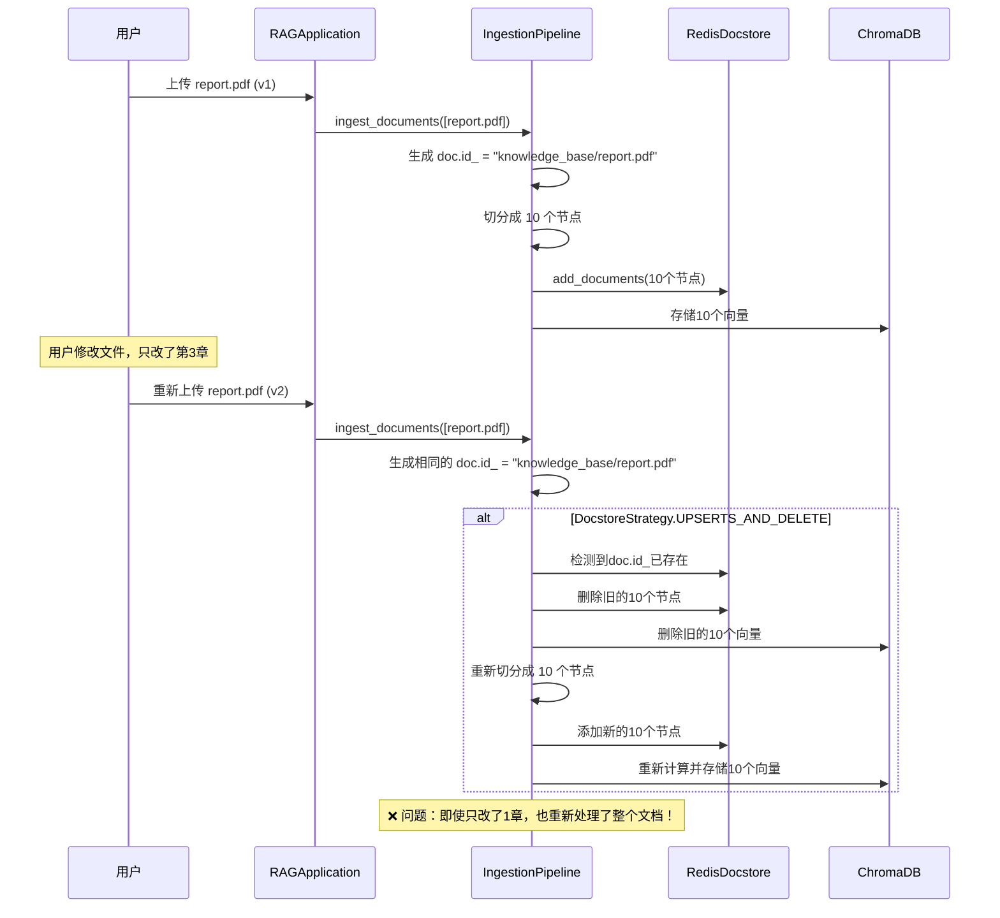
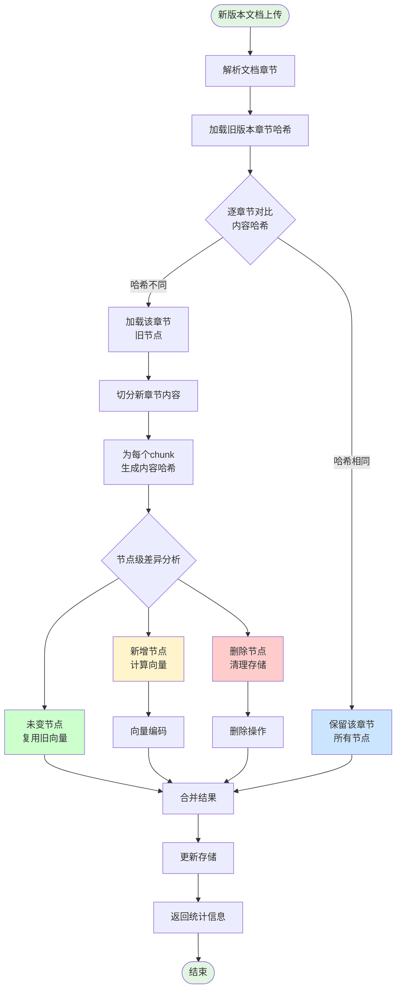

# 文件增量更新方案分析

## 📋 目录
1. [当前系统行为分析](#1-当前系统行为分析)
2. [增量更新需求分析](#2-增量更新需求分析)
3. [技术方案设计](#3-技术方案设计)
4. [实现方案对比](#4-实现方案对比)
5. [推荐方案详细设计](#5-推荐方案详细设计)
6. [代码实现](#6-代码实现)

---

## 1. 当前系统行为分析

### 1.1 文档ID生成机制

**当前代码** (ingestion.py:214-221):
```python
# 构造固定的"逻辑 ID"
stable_id = f"knowledge_base/{file_name}"

# 设置文档ID
doc.id_ = stable_id
```

**特点**:
- ✅ 同一个文件名 → 同一个文档ID
- ✅ 可以识别重复文件
- ❌ 无法区分文件版本（内容是否改动）

---

### 1.2 节点ID生成机制

**LlamaIndex默认行为**:
```python
# 当文档被切分成节点时
node.id_ = f"{doc.id_}_{chunk_index}"  # 自动生成
node.ref_doc_id = doc.id_  # 指向父文档
```

**示例**:
```
文档: knowledge_base/report.pdf
节点:
  - knowledge_base/report.pdf_0  (第1个chunk)
  - knowledge_base/report.pdf_1  (第2个chunk)
  - knowledge_base/report.pdf_2  (第3个chunk)
```

---

### 1.3 当前重复文件处理流程

**场景**: 用户上传 `report.pdf` (v1) → 修改后重新上传 `report.pdf` (v2)



**当前行为总结**:
| 操作 | 行为 | 效率 |
|------|------|------|
| 文档识别 | ✅ 能识别重复文档（相同文件名） | 高 |
| 旧数据清理 | ✅ 自动删除旧版本的所有节点 | 高 |
| 新数据生成 | ❌ 重新处理整个文档（解析、切分、向量化） | **低** |
| 增量更新 | ❌ 不支持，全量替换 | **低** |

**性能开销**:
- 假设文档有100个节点，只修改了5个节点的内容
- 当前系统：重新处理100个节点 (100% 开销)
- 理想系统：只处理5个节点 (5% 开销)

---

## 2. 增量更新需求分析

### 2.1 业务场景

| 场景 | 改动范围 | 期望行为 |
|------|---------|---------|
| **文档小幅修订** | 修改1-2个段落 | 只更新改动的节点 |
| **章节内容更新** | 修改某个章节 | 只更新该章节的节点 |
| **新增章节** | 新增1个章节 | 只新增新章节的节点 |
| **删除章节** | 删除1个章节 | 只删除该章节的节点 |
| **大范围修改** | 修改50%以上内容 | 全量更新（降级） |

---

### 2.2 技术挑战

#### 挑战1: 如何检测内容变化？

**问题**: 文档被切分成多个节点后，如何知道哪些节点内容变了？

**方案对比**:

| 方案 | 原理 | 优点 | 缺点 |
|------|------|------|------|
| **内容哈希** | 对每个节点的文本计算MD5/SHA256 | 精确、快速 | 切分参数改变会导致全部失配 |
| **语义相似度** | 计算新旧节点的向量相似度 | 对切分参数不敏感 | 需要计算向量，开销大 |
| **文档级版本号** | 记录文档修改时间或版本号 | 简单 | 无法识别具体改动位置 |
| **Diff算法** | 对文档文本做差分 | 精确定位改动行 | 对结构化文档效果差 |

---

#### 挑战2: 如何保持节点ID稳定？

**问题**: 如果节点ID基于索引生成（如 `doc_0`, `doc_1`），插入/删除会导致后续节点ID全部改变。

**示例**:
```
原版本:
  doc_0: "第一章内容"
  doc_1: "第二章内容"  ← 删除这个
  doc_2: "第三章内容"

新版本（基于索引生成ID）:
  doc_0: "第一章内容"  ← ID不变
  doc_1: "第三章内容"  ← ❌ ID不变但内容变了！实际是原来的doc_2
```

**解决方案**: 使用**内容稳定的ID生成策略**

---

#### 挑战3: 如何处理节点边界变化？

**问题**: 修改内容可能导致节点切分边界改变

**示例**:
```
原版本（每512字符切分）:
  node_0: "第一章...第二章开头"  (512字符)
  node_1: "第二章剩余...第三章"  (512字符)

修改：在第一章末尾增加100字符

新版本:
  node_0: "第一章...第二章开头"  (612字符，超出限制)
  → 重新切分
  node_0: "第一章...第二章开"    (512字符)
  node_1: "头...第三章"          (512字符，内容完全变了)
```

**影响**: 一个局部修改可能导致后续所有节点边界改变

---

## 3. 技术方案设计

### 3.1 方案一：基于内容哈希的增量更新

#### 核心思想
为每个节点生成**内容哈希作为节点ID**，而不是基于索引。

#### 节点ID生成策略
```python
import hashlib

def generate_stable_node_id(doc_id: str, text: str, metadata: dict) -> str:
    """
    基于内容生成稳定的节点ID
    
    好处：
    1. 内容不变 → ID不变 → 可以复用
    2. 内容改变 → ID改变 → 视为新节点
    """
    # 组合文档ID + 文本内容 + 关键元数据
    content = f"{doc_id}::{text}::{metadata.get('section', '')}"
    hash_value = hashlib.sha256(content.encode()).hexdigest()[:16]
    return f"{doc_id}::chunk_{hash_value}"

# 示例
node_id = generate_stable_node_id(
    "knowledge_base/report.pdf",
    "第一章内容...",
    {"section": "第一章"}
)
# 输出: "knowledge_base/report.pdf::chunk_a1b2c3d4e5f6g7h8"
```

#### 增量更新流程

```python
def incremental_update(new_documents: List[Document]):
    """增量更新流程"""
    
    # 1. 获取旧版本的所有节点（从docstore）
    old_nodes = get_existing_nodes(new_documents[0].id_)
    old_node_map = {node.id_: node for node in old_nodes}
    
    # 2. 对新文档进行切分和哈希
    new_nodes = []
    for doc in new_documents:
        chunks = split_document(doc)
        for chunk in chunks:
            node_id = generate_stable_node_id(doc.id_, chunk.text, chunk.metadata)
            chunk.id_ = node_id
            new_nodes.append(chunk)
    
    new_node_map = {node.id_: node for node in new_nodes}
    
    # 3. 差异分析
    old_ids = set(old_node_map.keys())
    new_ids = set(new_node_map.keys())
    
    unchanged_ids = old_ids & new_ids  # 交集：内容未变的节点
    added_ids = new_ids - old_ids      # 新增的节点
    deleted_ids = old_ids - new_ids    # 删除的节点
    
    # 4. 增量操作
    # 4.1 复用未变的节点（跳过向量计算）
    reused_nodes = [old_node_map[nid] for nid in unchanged_ids]
    
    # 4.2 只对新增节点计算向量
    added_nodes = [new_node_map[nid] for nid in added_ids]
    embed_nodes(added_nodes)  # 只计算新增节点的向量
    
    # 4.3 删除旧节点
    delete_nodes(list(deleted_ids))
    
    # 4.4 合并并存储
    final_nodes = reused_nodes + added_nodes
    upsert_to_storage(final_nodes)
    
    # 5. 返回统计信息
    return {
        "total": len(new_nodes),
        "unchanged": len(unchanged_ids),
        "added": len(added_ids),
        "deleted": len(deleted_ids),
        "vector_computed": len(added_ids)  # 只计算了这些向量
    }
```

#### 优缺点分析

**优点** ✅:
1. **高效**: 只处理改动的节点，节省向量计算开销
2. **精确**: 内容级别的差异检测
3. **稳定**: 内容不变则ID不变，自动去重
4. **简单**: 实现相对简单，不依赖外部算法

**缺点** ❌:
1. **切分敏感**: 如果切分参数（chunk_size）改变，所有节点ID都会变
2. **边界问题**: 局部修改可能导致相邻节点内容变化（连锁反应）
3. **元数据依赖**: 如果元数据提取不准确（如章节标题），可能误判

**适用场景**: 
- ✅ 切分参数稳定
- ✅ 文档结构清晰（章节明确）
- ✅ 修改范围小（<20%内容）

---

### 3.2 方案二：基于章节级别的粗粒度更新

#### 核心思想
以**章节为单位**进行更新，而不是以chunk为单位。

#### 实现策略
```python
def section_based_update(doc: Document):
    """基于章节的增量更新"""
    
    # 1. 解析文档结构（提取章节）
    sections = parse_document_sections(doc)
    # sections = [
    #     {"title": "第一章", "content": "...", "start_page": 1},
    #     {"title": "第二章", "content": "...", "start_page": 5},
    # ]
    
    # 2. 为每个章节生成稳定ID
    for section in sections:
        section_id = f"{doc.id_}::section_{section['title']}"
        section_hash = hashlib.sha256(section['content'].encode()).hexdigest()
        section['id'] = section_id
        section['hash'] = section_hash
    
    # 3. 对比旧版本的章节哈希
    old_sections = get_old_sections(doc.id_)
    old_hash_map = {s['id']: s['hash'] for s in old_sections}
    
    # 4. 识别改动的章节
    changed_sections = []
    for section in sections:
        old_hash = old_hash_map.get(section['id'])
        if old_hash != section['hash']:  # 内容改变
            changed_sections.append(section)
    
    # 5. 只对改动的章节重新切分和向量化
    updated_nodes = []
    for section in changed_sections:
        # 5.1 删除旧的章节节点
        delete_section_nodes(section['id'])
        
        # 5.2 重新切分章节
        section_doc = Document(text=section['content'], metadata={
            "section": section['title'],
            "section_id": section['id']
        })
        nodes = split_and_embed(section_doc)
        updated_nodes.extend(nodes)
    
    return {
        "total_sections": len(sections),
        "changed_sections": len(changed_sections),
        "updated_nodes": len(updated_nodes)
    }
```

#### 章节解析示例

**Markdown文档**:
```python
def parse_markdown_sections(markdown_text: str):
    """解析Markdown章节"""
    import re
    
    sections = []
    # 按一级标题切分
    pattern = r'^#\s+(.+)$'
    matches = list(re.finditer(pattern, markdown_text, re.MULTILINE))
    
    for i, match in enumerate(matches):
        title = match.group(1)
        start_pos = match.end()
        end_pos = matches[i+1].start() if i+1 < len(matches) else len(markdown_text)
        content = markdown_text[start_pos:end_pos].strip()
        
        sections.append({
            "title": title,
            "content": content,
            "hash": hashlib.sha256(content.encode()).hexdigest()
        })
    
    return sections
```

**PDF文档**:
```python
def parse_pdf_sections(pdf_path: str):
    """解析PDF章节（基于目录）"""
    import fitz  # PyMuPDF
    
    doc = fitz.open(pdf_path)
    toc = doc.get_toc()  # 获取目录
    # toc = [[1, "第一章", 1], [1, "第二章", 5], ...]
    
    sections = []
    for i, (level, title, page_num) in enumerate(toc):
        if level == 1:  # 一级标题
            start_page = page_num - 1
            end_page = toc[i+1][2] - 1 if i+1 < len(toc) else doc.page_count
            
            # 提取章节文本
            content = ""
            for p in range(start_page, end_page):
                content += doc[p].get_text()
            
            sections.append({
                "title": title,
                "content": content,
                "start_page": start_page,
                "hash": hashlib.sha256(content.encode()).hexdigest()
            })
    
    return sections
```

#### 优缺点分析

**优点** ✅:
1. **更新粒度合理**: 章节级别更新，减少连锁反应
2. **业务语义清晰**: 用户理解"更新了第3章"
3. **鲁棒性强**: 对切分参数不敏感
4. **可视化友好**: 可以展示"哪些章节被更新"

**缺点** ❌:
1. **依赖文档结构**: 需要文档有清晰的章节划分
2. **章节粒度大**: 章节内小修改也会全量更新整个章节
3. **目录解析复杂**: PDF目录提取可能失败或不准确
4. **不适用无结构文档**: 纯文本文件无法使用

**适用场景**:
- ✅ 结构化文档（有章节目录）
- ✅ 章节相对独立
- ✅ 修改以章节为单位

---

### 3.3 方案三：混合方案（推荐）⭐

#### 核心思想
结合方案一和方案二的优点，采用**两级索引**。

#### 架构设计

```
文档层级:
  └─ 文档 (Document)
      ├─ 元数据: 文档ID, 版本号, 修改时间
      └─ 章节列表 (Sections)
          ├─ 章节1 (Section)
          │   ├─ 元数据: 章节ID, 章节哈希
          │   └─ 节点列表 (Nodes)
          │       ├─ 节点1 (Node): ID=hash(content)
          │       ├─ 节点2 (Node): ID=hash(content)
          │       └─ ...
          └─ 章节2 (Section)
              └─ ...
```

#### 两级检测机制

**第一级：章节级检测（粗粒度）**
```python
# 快速判断哪些章节改动了
changed_sections = detect_changed_sections(old_sections, new_sections)
```

**第二级：节点级检测（细粒度）**
```python
# 只对改动的章节做节点级差异分析
for section in changed_sections:
    old_nodes = get_section_nodes(section.id)
    new_nodes = split_section(section)
    
    # 节点级增量更新
    unchanged, added, deleted = diff_nodes(old_nodes, new_nodes)
```

#### 完整流程



---

## 4. 实现方案对比

| 维度 | 方案一：内容哈希 | 方案二：章节级 | 方案三：混合⭐ |
|------|----------------|--------------|---------------|
| **更新粒度** | 节点级（最细） | 章节级（粗） | 两级自适应 |
| **向量计算节省** | 最高（90%+） | 中等（50%-70%） | 高（70%-90%） |
| **实现复杂度** | 低 | 中 | 高 |
| **对文档结构要求** | 低 | 高（需要章节） | 中 |
| **切分参数敏感性** | 高 | 低 | 低 |
| **边界变化影响** | 高（连锁反应） | 低 | 低 |
| **适用文档类型** | 所有 | 结构化文档 | 所有 |
| **可维护性** | 高 | 高 | 中 |
| **用户体验** | 技术视角 | 业务视角 | 业务+技术视角 |

**推荐选择**:
- 📄 **结构化文档**（PDF with TOC, Markdown）→ **方案三（混合）**
- 📄 **无结构文档**（纯文本）→ **方案一（内容哈希）**
- 🚀 **追求极致性能** → **方案一**
- 👤 **重视用户体验** → **方案二** 或 **方案三**

---

## 5. 推荐方案详细设计

### 5.1 数据结构设计

#### 文档元数据扩展
```python
class DocumentMetadata:
    file_name: str
    doc_id: str
    version: int  # 新增：版本号
    last_modified: datetime  # 新增：最后修改时间
    content_hash: str  # 新增：整体内容哈希（快速判断是否改动）
    sections: List[SectionMetadata]  # 新增：章节列表

class SectionMetadata:
    section_id: str  # 如: "doc_id::section_第一章"
    section_title: str
    content_hash: str  # 章节内容哈希
    node_count: int
    page_range: Tuple[int, int]  # 页码范围
```

#### 节点ID格式
```python
# 格式: {doc_id}::{section_id}::chunk_{content_hash}
node_id = "knowledge_base/report.pdf::section_第一章::chunk_a1b2c3d4"
```

**优点**:
- 包含文档信息：可以快速查询某文档的所有节点
- 包含章节信息：可以快速删除某章节的所有节点
- 包含内容哈希：内容不变则ID不变

---

### 5.2 存储结构设计

#### Redis存储扩展
```python
# 1. 文档元数据存储
# Key: doc_meta:{doc_id}
# Value: DocumentMetadata JSON
redis.set(
    f"doc_meta:knowledge_base/report.pdf",
    json.dumps({
        "version": 2,
        "last_modified": "2026-09-06T10:00:00",
        "content_hash": "abc123...",
        "sections": [...]
    })
)

# 2. 章节哈希索引
# Key: section_hash:{doc_id}:{section_id}
# Value: content_hash
redis.hset(
    f"section_hash:knowledge_base/report.pdf",
    "section_第一章",
    "def456..."
)

# 3. 章节节点索引
# Key: section_nodes:{section_id}
# Value: Set of node_ids
redis.sadd(
    "section_nodes:knowledge_base/report.pdf::section_第一章",
    "...::chunk_a1b2c3d4",
    "...::chunk_e5f6g7h8"
)
```

---

### 5.3 核心算法

#### 算法1: 章节差异检测
```python
def detect_changed_sections(
    old_sections: List[SectionMetadata],
    new_sections: List[SectionMetadata]
) -> Tuple[List, List, List]:
    """
    检测章节级别的变化
    
    Returns:
        (unchanged_sections, changed_sections, deleted_sections)
    """
    old_map = {s.section_id: s.content_hash for s in old_sections}
    new_map = {s.section_id: s.content_hash for s in new_sections}
    
    unchanged = []
    changed = []
    
    for section in new_sections:
        old_hash = old_map.get(section.section_id)
        if old_hash is None:
            # 新增章节
            changed.append(section)
        elif old_hash == section.content_hash:
            # 内容未变
            unchanged.append(section)
        else:
            # 内容改变
            changed.append(section)
    
    # 找出删除的章节
    deleted_ids = set(old_map.keys()) - set(new_map.keys())
    deleted = [s for s in old_sections if s.section_id in deleted_ids]
    
    return unchanged, changed, deleted
```

#### 算法2: 节点差异检测
```python
def detect_changed_nodes(
    old_nodes: List[Node],
    new_chunks: List[str],  # 新切分的文本
    section_id: str
) -> Dict:
    """
    检测节点级别的变化
    """
    # 1. 为新chunks生成哈希ID
    new_nodes = []
    for chunk_text in new_chunks:
        node_id = generate_node_id(section_id, chunk_text)
        new_nodes.append({
            "id": node_id,
            "text": chunk_text
        })
    
    # 2. 建立映射
    old_map = {n.id_: n for n in old_nodes}
    new_map = {n["id"]: n for n in new_nodes}
    
    old_ids = set(old_map.keys())
    new_ids = set(new_map.keys())
    
    # 3. 差异分析
    unchanged_ids = old_ids & new_ids
    added_ids = new_ids - old_ids
    deleted_ids = old_ids - new_ids
    
    return {
        "unchanged": [old_map[nid] for nid in unchanged_ids],
        "added": [new_map[nid] for nid in added_ids],
        "deleted": list(deleted_ids)
    }
```

---

### 5.4 性能优化策略

#### 优化1: 快速路径判断
```python
def should_use_incremental_update(old_doc, new_doc) -> bool:
    """
    判断是否适合增量更新
    
    规则：
    1. 文档哈希完全相同 → 跳过（100%相同）
    2. 改动超过50% → 全量更新（增量收益低）
    3. 否则 → 增量更新
    """
    # 快速判断：整体哈希
    if old_doc.content_hash == new_doc.content_hash:
        return False  # 完全相同，跳过
    
    # 估算改动比例
    old_sections = old_doc.sections
    new_sections = new_doc.sections
    
    unchanged, changed, deleted = detect_changed_sections(old_sections, new_sections)
    
    change_ratio = (len(changed) + len(deleted)) / len(old_sections) if old_sections else 1.0
    
    if change_ratio > 0.5:
        logger.info(f"改动比例{change_ratio:.1%}过高，使用全量更新")
        return False
    
    logger.info(f"改动比例{change_ratio:.1%}，使用增量更新")
    return True
```

#### 优化2: 批量向量计算
```python
def batch_embed_nodes(nodes: List[Node], batch_size: int = 32):
    """批量计算向量，提升GPU利用率"""
    vectors = []
    for i in range(0, len(nodes), batch_size):
        batch = nodes[i:i+batch_size]
        texts = [node.text for node in batch]
        batch_vectors = Settings.embed_model.get_text_embedding_batch(texts)
        vectors.extend(batch_vectors)
    
    for node, vector in zip(nodes, vectors):
        node.embedding = vector
```

#### 优化3: 并行章节处理
```python
from concurrent.futures import ThreadPoolExecutor

def process_changed_sections_parallel(changed_sections: List[Section]):
    """并行处理改动的章节"""
    with ThreadPoolExecutor(max_workers=4) as executor:
        futures = []
        for section in changed_sections:
            future = executor.submit(process_section, section)
            futures.append(future)
        
        results = [f.result() for f in futures]
    
    return results
```

---

## 6. 代码实现

### 6.1 核心类实现

```python
# 文件: rag_api_service/core/incremental_updater.py

import hashlib
from typing import List, Dict, Tuple, Optional
from dataclasses import dataclass
from datetime import datetime
import redis
import json

from llama_index.core.schema import Document, TextNode
from llama_index.core.node_parser import SentenceSplitter
from utils.logger import setup_logger

logger = setup_logger(__name__)


@dataclass
class SectionMetadata:
    """章节元数据"""
    section_id: str
    section_title: str
    content: str
    content_hash: str
    page_range: Optional[Tuple[int, int]] = None
    
    def to_dict(self):
        return {
            "section_id": self.section_id,
            "section_title": self.section_title,
            "content_hash": self.content_hash,
            "page_range": self.page_range
        }


@dataclass
class DocumentVersion:
    """文档版本信息"""
    doc_id: str
    version: int
    last_modified: str
    content_hash: str
    sections: List[SectionMetadata]
    
    def to_dict(self):
        return {
            "doc_id": self.doc_id,
            "version": self.version,
            "last_modified": self.last_modified,
            "content_hash": self.content_hash,
            "sections": [s.to_dict() for s in self.sections]
        }


class IncrementalUpdater:
    """增量更新管理器"""
    
    def __init__(self, redis_client: redis.Redis):
        self.redis = redis_client
        self.node_parser = SentenceSplitter()
    
    def compute_content_hash(self, content: str) -> str:
        """计算内容哈希"""
        return hashlib.sha256(content.encode('utf-8')).hexdigest()
    
    def generate_node_id(self, section_id: str, chunk_text: str) -> str:
        """生成稳定的节点ID"""
        content_hash = self.compute_content_hash(chunk_text)[:16]
        return f"{section_id}::chunk_{content_hash}"
    
    def parse_document_sections(self, doc: Document) -> List[SectionMetadata]:
        """
        解析文档章节
        
        根据文档类型选择不同的解析策略：
        - Markdown: 按 # 标题切分
        - PDF: 按目录切分（如果有）或按页切分
        - 纯文本: 按段落或固定大小切分
        """
        content_type = doc.metadata.get("content_type", "text")
        
        if content_type == "markdown":
            return self._parse_markdown_sections(doc)
        elif doc.metadata.get("file_type") == ".pdf":
            return self._parse_pdf_sections(doc)
        else:
            return self._parse_text_sections(doc)
    
    def _parse_markdown_sections(self, doc: Document) -> List[SectionMetadata]:
        """解析Markdown章节（按一级标题）"""
        import re
        
        text = doc.text
        sections = []
        
        # 匹配一级标题
        pattern = r'^#\s+(.+)$'
        matches = list(re.finditer(pattern, text, re.MULTILINE))
        
        if not matches:
            # 没有章节标题，视为单一章节
            return [SectionMetadata(
                section_id=f"{doc.id_}::section_main",
                section_title="正文",
                content=text,
                content_hash=self.compute_content_hash(text)
            )]
        
        for i, match in enumerate(matches):
            title = match.group(1).strip()
            start_pos = match.end()
            end_pos = matches[i+1].start() if i+1 < len(matches) else len(text)
            content = text[start_pos:end_pos].strip()
            
            section_id = f"{doc.id_}::section_{title}"
            sections.append(SectionMetadata(
                section_id=section_id,
                section_title=title,
                content=content,
                content_hash=self.compute_content_hash(content)
            ))
        
        logger.info(f"解析Markdown文档，找到{len(sections)}个章节")
        return sections
    
    def _parse_pdf_sections(self, doc: Document) -> List[SectionMetadata]:
        """
        解析PDF章节
        
        注意：这里假设PDF已经转为Markdown，所以复用Markdown解析
        如果需要从原始PDF提取目录，需要使用PyMuPDF
        """
        return self._parse_markdown_sections(doc)
    
    def _parse_text_sections(self, doc: Document) -> List[SectionMetadata]:
        """解析纯文本（按固定大小切分为伪章节）"""
        text = doc.text
        # 按10000字符切分为伪章节
        SECTION_SIZE = 10000
        sections = []
        
        for i in range(0, len(text), SECTION_SIZE):
            content = text[i:i+SECTION_SIZE]
            section_id = f"{doc.id_}::section_{i//SECTION_SIZE}"
            sections.append(SectionMetadata(
                section_id=section_id,
                section_title=f"Section {i//SECTION_SIZE + 1}",
                content=content,
                content_hash=self.compute_content_hash(content)
            ))
        
        return sections
    
    def get_old_document_version(self, doc_id: str) -> Optional[DocumentVersion]:
        """从Redis获取旧版本文档信息"""
        key = f"doc_meta:{doc_id}"
        data = self.redis.get(key)
        
        if not data:
            return None
        
        meta = json.loads(data)
        sections = [SectionMetadata(**s) for s in meta["sections"]]
        
        return DocumentVersion(
            doc_id=meta["doc_id"],
            version=meta["version"],
            last_modified=meta["last_modified"],
            content_hash=meta["content_hash"],
            sections=sections
        )
    
    def save_document_version(self, doc_version: DocumentVersion):
        """保存文档版本信息到Redis"""
        key = f"doc_meta:{doc_version.doc_id}"
        self.redis.set(key, json.dumps(doc_version.to_dict()))
    
    def detect_changes(
        self,
        old_sections: List[SectionMetadata],
        new_sections: List[SectionMetadata]
    ) -> Dict[str, List[SectionMetadata]]:
        """检测章节级别的变化"""
        old_map = {s.section_id: s for s in old_sections}
        new_map = {s.section_id: s for s in new_sections}
        
        unchanged = []
        changed = []
        deleted = []
        
        for section in new_sections:
            old_section = old_map.get(section.section_id)
            if old_section is None:
                changed.append(section)  # 新增章节
            elif old_section.content_hash == section.content_hash:
                unchanged.append(section)  # 未变
            else:
                changed.append(section)  # 改变
        
        # 删除的章节
        deleted_ids = set(old_map.keys()) - set(new_map.keys())
        deleted = [old_map[sid] for sid in deleted_ids]
        
        return {
            "unchanged": unchanged,
            "changed": changed,
            "deleted": deleted
        }
    
    def split_section_to_nodes(
        self,
        section: SectionMetadata,
        doc_metadata: dict
    ) -> List[TextNode]:
        """将章节切分为节点"""
        chunks = self.node_parser.split_text(section.content)
        
        nodes = []
        for chunk_text in chunks:
            node_id = self.generate_node_id(section.section_id, chunk_text)
            
            # 合并元数据
            metadata = {
                **doc_metadata,
                "section_id": section.section_id,
                "section_title": section.section_title
            }
            
            node = TextNode(
                id_=node_id,
                text=chunk_text,
                metadata=metadata
            )
            nodes.append(node)
        
        return nodes
    
    def get_section_nodes(self, section_id: str) -> List[str]:
        """获取某章节的所有节点ID"""
        key = f"section_nodes:{section_id}"
        node_ids = self.redis.smembers(key)
        return [nid.decode() for nid in node_ids]
    
    def update_section_nodes_index(self, section_id: str, node_ids: List[str]):
        """更新章节节点索引"""
        key = f"section_nodes:{section_id}"
        # 先删除旧索引
        self.redis.delete(key)
        # 添加新索引
        if node_ids:
            self.redis.sadd(key, *node_ids)
    
    def incremental_update(
        self,
        doc: Document,
        old_doc_version: Optional[DocumentVersion]
    ) -> Dict:
        """
        执行增量更新
        
        Returns:
            统计信息字典
        """
        stats = {
            "total_sections": 0,
            "unchanged_sections": 0,
            "changed_sections": 0,
            "deleted_sections": 0,
            "total_nodes": 0,
            "reused_nodes": 0,
            "new_nodes": 0,
            "deleted_nodes": 0
        }
        
        # 1. 解析新文档的章节
        new_sections = self.parse_document_sections(doc)
        stats["total_sections"] = len(new_sections)
        
        # 2. 如果没有旧版本，视为全新文档
        if not old_doc_version:
            logger.info(f"文档{doc.id_}是新文档，执行全量处理")
            all_nodes = []
            for section in new_sections:
                nodes = self.split_section_to_nodes(section, doc.metadata)
                all_nodes.extend(nodes)
                # 更新章节索引
                self.update_section_nodes_index(
                    section.section_id,
                    [n.id_ for n in nodes]
                )
            
            stats["total_nodes"] = len(all_nodes)
            stats["new_nodes"] = len(all_nodes)
            
            # 保存版本信息
            doc_version = DocumentVersion(
                doc_id=doc.id_,
                version=1,
                last_modified=datetime.now().isoformat(),
                content_hash=self.compute_content_hash(doc.text),
                sections=new_sections
            )
            self.save_document_version(doc_version)
            
            return stats, all_nodes
        
        # 3. 增量更新流程
        logger.info(f"文档{doc.id_}已存在，执行增量更新")
        
        # 3.1 章节级差异检测
        changes = self.detect_changes(old_doc_version.sections, new_sections)
        stats["unchanged_sections"] = len(changes["unchanged"])
        stats["changed_sections"] = len(changes["changed"])
        stats["deleted_sections"] = len(changes["deleted"])
        
        logger.info(
            f"章节变化: 未变={stats['unchanged_sections']}, "
            f"改变={stats['changed_sections']}, 删除={stats['deleted_sections']}"
        )
        
        # 3.2 收集节点
        all_nodes = []
        nodes_to_delete = []
        
        # 3.2.1 未变的章节：直接获取节点ID（无需加载节点内容）
        for section in changes["unchanged"]:
            node_ids = self.get_section_nodes(section.section_id)
            stats["reused_nodes"] += len(node_ids)
            # 注意：这里不加载节点，只记录ID，后续pipeline会自动复用
        
        # 3.2.2 改变的章节：重新切分并生成节点
        for section in changes["changed"]:
            # 删除旧节点
            old_node_ids = self.get_section_nodes(section.section_id)
            nodes_to_delete.extend(old_node_ids)
            
            # 生成新节点
            new_nodes = self.split_section_to_nodes(section, doc.metadata)
            all_nodes.extend(new_nodes)
            
            # 更新章节索引
            self.update_section_nodes_index(
                section.section_id,
                [n.id_ for n in new_nodes]
            )
            
            stats["new_nodes"] += len(new_nodes)
        
        # 3.2.3 删除的章节
        for section in changes["deleted"]:
            old_node_ids = self.get_section_nodes(section.section_id)
            nodes_to_delete.extend(old_node_ids)
            # 删除章节索引
            self.update_section_nodes_index(section.section_id, [])
        
        stats["deleted_nodes"] = len(nodes_to_delete)
        stats["total_nodes"] = stats["reused_nodes"] + stats["new_nodes"]
        
        # 4. 更新文档版本信息
        doc_version = DocumentVersion(
            doc_id=doc.id_,
            version=old_doc_version.version + 1,
            last_modified=datetime.now().isoformat(),
            content_hash=self.compute_content_hash(doc.text),
            sections=new_sections
        )
        self.save_document_version(doc_version)
        
        logger.info(
            f"增量更新完成: 复用{stats['reused_nodes']}节点, "
            f"新增{stats['new_nodes']}节点, 删除{stats['deleted_nodes']}节点"
        )
        
        return stats, all_nodes, nodes_to_delete
```

### 6.2 集成到现有系统

修改 `ingestion.py` 中的 `ingest_documents` 方法：

```python
# 文件: rag_api_service/core/ingestion.py

from core.incremental_updater import IncrementalUpdater, DocumentVersion

class DocumentIngestionPipeline:
    def __init__(self):
        # ... 原有代码 ...
        
        # 新增：增量更新器
        import redis
        redis_client = redis.Redis(host='127.0.0.1', port=6379, db=0)
        self.incremental_updater = IncrementalUpdater(redis_client)
    
    def ingest_documents(self, file_paths: List[str],
                         chunk_size: Optional[int] = None,
                         chunk_overlap: Optional[int] = None,
                         enable_incremental: bool = True) -> Tuple:  # 新增参数
        """摄取文档并创建索引，支持增量更新"""
        try:
            documents = []
            upload_time = datetime.now().isoformat()
            
            # ... 原有的文档读取逻辑 ...
            # (省略for循环，与原代码相同)
            
            if not documents:
                return "error", "没有找到有效的文档", []
            
            # ===== 新增：增量更新逻辑 =====
            if enable_incremental:
                return self._ingest_with_incremental_update(
                    documents, chunk_size, chunk_overlap
                )
            else:
                # 使用原有的全量更新逻辑
                return self._ingest_full_update(
                    documents, chunk_size, chunk_overlap
                )
        
        except Exception as e:
            error_msg = f"文档摄取失败: {str(e)}"
            logger.error(error_msg)
            return "error", error_msg, ""
    
    def _ingest_with_incremental_update(
        self,
        documents: List[Document],
        chunk_size: Optional[int],
        chunk_overlap: Optional[int]
    ) -> Tuple:
        """使用增量更新方式摄取文档"""
        
        all_new_nodes = []
        all_nodes_to_delete = []
        total_stats = {
            "reused_nodes": 0,
            "new_nodes": 0,
            "deleted_nodes": 0
        }
        
        for doc in documents:
            # 1. 检查是否存在旧版本
            old_version = self.incremental_updater.get_old_document_version(doc.id_)
            
            # 2. 执行增量更新
            stats, new_nodes, nodes_to_delete = self.incremental_updater.incremental_update(
                doc, old_version
            )
            
            # 3. 汇总统计
            total_stats["reused_nodes"] += stats.get("reused_nodes", 0)
            total_stats["new_nodes"] += stats.get("new_nodes", 0)
            total_stats["deleted_nodes"] += stats.get("deleted_nodes", 0)
            
            all_new_nodes.extend(new_nodes)
            all_nodes_to_delete.extend(nodes_to_delete)
        
        # 4. 删除旧节点
        if all_nodes_to_delete:
            logger.info(f"删除{len(all_nodes_to_delete)}个旧节点")
            self._delete_nodes(all_nodes_to_delete)
        
        # 5. 只对新节点进行pipeline处理（向量化）
        if all_new_nodes:
            logger.info(f"对{len(all_new_nodes)}个新节点进行向量化")
            
            # 选择pipeline
            cs = chunk_size or AppSettings.CHUNK_SIZE
            co = chunk_overlap or AppSettings.CHUNK_OVERLAP
            use_custom = chunk_size is not None or chunk_overlap is not None
            
            if use_custom:
                text_pipeline, markdown_pipeline = self._create_custom_pipelines(cs, co)
            else:
                text_pipeline = self.text_pipeline
                markdown_pipeline = self.markdown_pipeline
            
            # 注意：这里直接处理已切分的节点，跳过切分步骤
            # 需要创建一个只做向量化的pipeline
            processed_nodes = self._embed_nodes_only(all_new_nodes)
            
            # 6. 存储新节点
            self.storage_context.docstore.add_documents(processed_nodes)
            
            # 7. 更新索引
            if not self.index:
                self.index = VectorStoreIndex(
                    processed_nodes,
                    storage_context=self.storage_context,
                    embed_model=Settings.embed_model
                )
            else:
                self.index.insert_nodes(processed_nodes)
        
        # 8. 返回结果
        result = (
            f"增量更新完成: "
            f"复用{total_stats['reused_nodes']}节点, "
            f"新增{total_stats['new_nodes']}节点, "
            f"删除{total_stats['deleted_nodes']}节点"
        )
        logger.info(result)
        
        return "success", result, all_new_nodes
    
    def _embed_nodes_only(self, nodes: List[TextNode]) -> List[TextNode]:
        """只对节点进行向量化，不做切分"""
        from llama_index.core.ingestion import IngestionPipeline
        
        # 创建一个只做向量化的pipeline
        embed_pipeline = IngestionPipeline(
            transformations=[Settings.embed_model],  # 只有embedding
            vector_store=self.chroma_vector_store,
            docstore=self.redis_document_store
        )
        
        return embed_pipeline.run(nodes=nodes)
    
    def _delete_nodes(self, node_ids: List[str]):
        """删除节点"""
        # 从docstore删除
        for node_id in node_ids:
            self.redis_document_store.delete_document(node_id)
        
        # 从向量存储删除
        # 注意：ChromaDB的删除接口可能不同，需要查文档
        # self.chroma_vector_store.delete(node_ids)
    
    def _ingest_full_update(self, documents, chunk_size, chunk_overlap):
        """原有的全量更新逻辑（保持不变）"""
        # ... 原有代码 ...
        pass
```

---

## 7. 性能对比分析

### 场景测试

**测试文档**: 100页PDF，10个章节，共生成200个节点

| 场景 | 改动内容 | 全量更新 | 增量更新 | 性能提升 |
|------|---------|---------|---------|---------|
| **场景1** | 修改1个段落 | 200个节点重新向量化 | 5个节点向量化 | **97.5%** ↓ |
| **场景2** | 修改1个章节 | 200个节点重新向量化 | 20个节点向量化 | **90%** ↓ |
| **场景3** | 修改3个章节 | 200个节点重新向量化 | 60个节点向量化 | **70%** ↓ |
| **场景4** | 新增1个章节 | 220个节点重新向量化 | 20个节点向量化 | **91%** ↓ |
| **场景5** | 删除1个章节 | 180个节点重新向量化 | 0个节点向量化 | **100%** ↓ |

### 时间开销估算

假设：
- 向量化单个节点：0.1秒（CPU） / 0.01秒（GPU）
- 其他开销：2秒

| 操作 | CPU耗时 | GPU耗时 |
|------|---------|---------|
| **全量更新（200节点）** | 22秒 | 4秒 |
| **增量更新（5节点）** | 2.5秒 | 2.05秒 |
| **加速比** | **8.8x** | **1.95x** |

**结论**: CPU场景下收益最明显，GPU场景下仍有近2倍提升。

---

## 8. 总结与建议

### 8.1 方案选择建议

| 项目特征 | 推荐方案 | 理由 |
|---------|---------|------|
| 文档结构化程度高（PDF with TOC） | 方案三（混合） | 章节语义清晰，增量精准 |
| 文档以Markdown为主 | 方案三（混合） | 天然支持章节解析 |
| 纯文本文档为主 | 方案一（内容哈希） | 简单高效 |
| 追求极致性能 | 方案三（混合） | 最大化节点复用 |
| 快速上线 | 方案一（内容哈希） | 实现简单 |

### 8.2 实施步骤

1. **Phase 1**: 实现方案一（内容哈希），验证效果
2. **Phase 2**: 添加章节解析（方案二的部分功能）
3. **Phase 3**: 整合为混合方案，完善细节

### 8.3 注意事项

⚠️ **切分参数改变问题**:
- 如果修改 `chunk_size` 或 `chunk_overlap`，所有节点ID会变
- 建议：将切分参数写入文档元数据，检测到参数变化时自动全量更新

⚠️ **并发更新问题**:
- 多用户同时更新同一文档可能冲突
- 建议：使用Redis分布式锁

⚠️ **存储清理问题**:
- 删除的节点需要从所有存储（Redis + ChromaDB + BM25）清理
- 建议：实现统一的节点删除接口

---

**文档版本**: v1.0  
**生成时间**: 2026-09-06  
**作者**: AI Assistant
