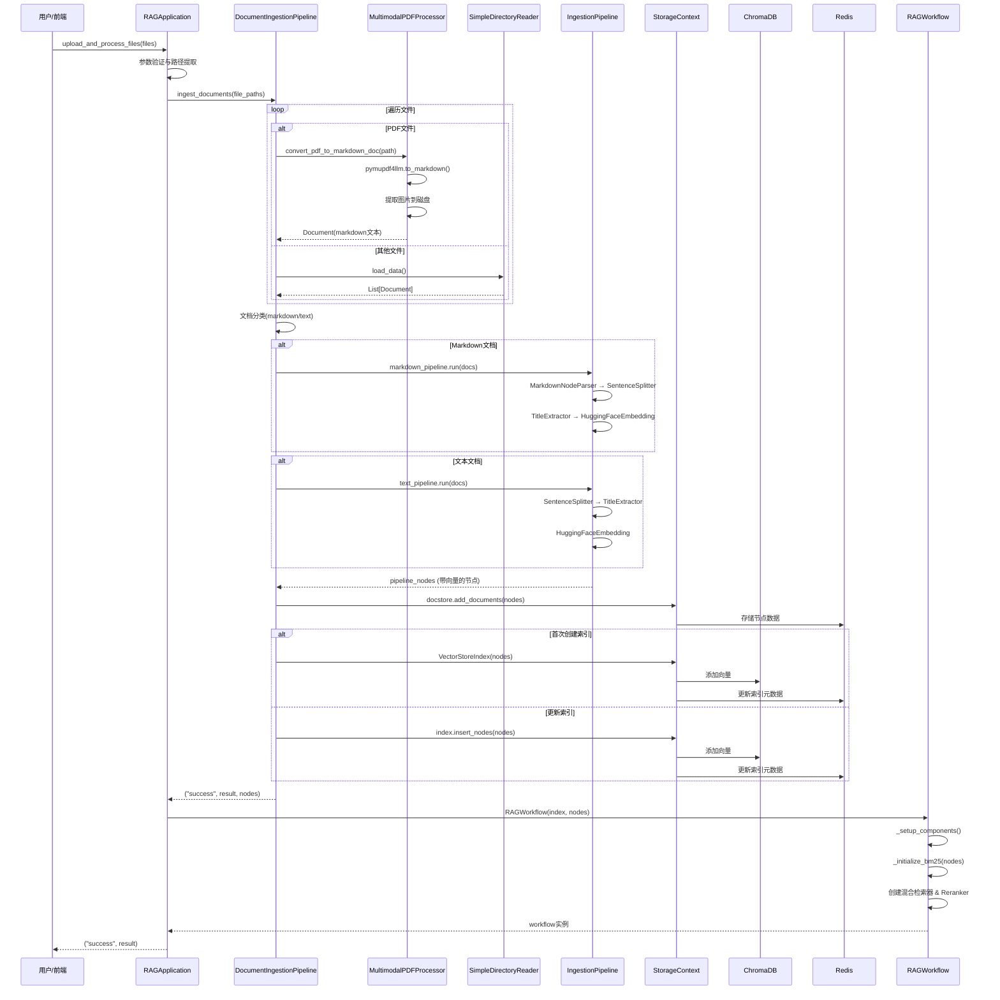
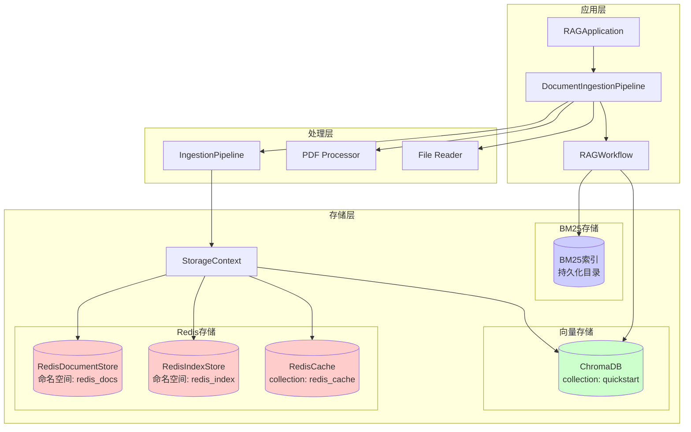

# 文件上传链路深度分析

## 📋 目录
1. [调用链总览表](#1-调用链总览表)
2. [各方法详细说明](#2-各方法详细说明)
3. [流程图](#3-流程图)
4. [关键路径总结](#4-关键路径总结)
5. [潜在风险点](#5-潜在风险点)

---

## 1. 调用链总览表

| 层级 | 方法签名 | 所属类/模块 | 文件位置 | 核心职责 |
|------|---------|------------|---------|---------|
| **L1** | `upload_and_process_files(files, chunk_size, chunk_overlap)` | RAGApplication | application.py:36 | 文件上传入口，参数验证与流程编排 |
| **L2** | `ingest_documents(file_paths, chunk_size, chunk_overlap)` | DocumentIngestionPipeline | ingestion.py:183 | 文档摄取主流程，文件解析与索引构建 |
| **L3** | `convert_pdf_to_markdown_doc(pdf_path)` | MultimodalPDFProcessor | pdf_parser.py:19 | PDF转Markdown，图片提取 |
| **L3** | `SimpleDirectoryReader.load_data()` | LlamaIndex内置 | - | 通用文件读取器 |
| **L3** | `_create_custom_pipelines(chunk_size, chunk_overlap)` | DocumentIngestionPipeline | ingestion.py:139 | 创建自定义分块参数的管道 |
| **L4** | `IngestionPipeline.run(documents)` | LlamaIndex内置 | - | 执行文档处理管道 |
| **L5** | `SentenceSplitter.transform()` | LlamaIndex内置 | - | 文本分块 |
| **L5** | `MarkdownNodeParser.transform()` | LlamaIndex内置 | - | Markdown解析与分块 |
| **L5** | `TitleExtractor.transform()` | LlamaIndex内置 | - | 标题提取 |
| **L5** | `HuggingFaceEmbedding.transform()` | LlamaIndex内置 | - | 向量编码 |
| **L4** | `StorageContext.docstore.add_documents(nodes)` | LlamaIndex内置 | - | 节点存储到Redis |
| **L4** | `VectorStoreIndex(nodes)` 或 `insert_nodes(nodes)` | LlamaIndex内置 | - | 创建/更新向量索引 |
| **L5** | `ChromaVectorStore.add()` | LlamaIndex内置 | - | 向量存储到ChromaDB |
| **L5** | `RedisIndexStore.update()` | LlamaIndex内置 | - | 索引元数据存储 |
| **L2** | `RAGWorkflow.__init__(index, pipeline_nodes)` | RAGWorkflow | workflow.py:19 | 工作流初始化 |
| **L3** | `_setup_components()` | RAGWorkflow | workflow.py:32 | 组件配置 |
| **L4** | `_initialize_bm25()` | RAGWorkflow | workflow.py:71 | BM25索引初始化 |
| **L5** | `BM25Retriever.from_defaults(nodes)` | LlamaIndex内置 | - | 构建BM25索引 |
| **L5** | `BM25Retriever.persist()` | LlamaIndex内置 | - | 持久化BM25索引 |

---

## 2. 各方法详细说明

### 2.1 L1: RAGApplication.upload_and_process_files()

**文件位置**: `rag_api_service/core/application.py:36`

**方法签名**:
```python
def upload_and_process_files(self, files, chunk_size=None, chunk_overlap=None) -> Tuple
```

**参数说明**:
- `files`: 文件对象列表，可以是Gradio文件对象或路径字符串
- `chunk_size`: 可选，自定义分块大小（默认512）
- `chunk_overlap`: 可选，自定义分块重叠（默认50）

**返回值**:
- 成功：`(status: str, result: str)` - ("success", "成功消息")
- 失败：`error_msg: str` - 错误消息字符串

**核心逻辑**:
1. **参数验证**: 检查文件列表是否为空
2. **路径提取**: 从文件对象中提取路径（兼容Gradio对象和字符串）
3. **委托处理**: 调用 `ingestion_pipeline.ingest_documents()`
4. **状态检查**: 验证返回状态是否为error
5. **工作流创建**: 如果索引创建成功，初始化RAGWorkflow

**异常处理**:
```python
try:
    # 核心逻辑
except Exception as e:
    error_msg = f"文件处理失败: {str(e)}"
    logger.error(error_msg)
    return error_msg  # ⚠️ 注意：异常路径返回字符串，正常路径返回元组
```

**依赖项**:
- `self.ingestion_pipeline`: DocumentIngestionPipeline实例
- `self.workflow`: RAGWorkflow实例（可选）
- `logger`: 日志记录器

**潜在问题**:
- ❌ **返回值不一致**: 成功返回Tuple，失败返回str，调用方需要类型检查
- ❌ **无事务支持**: 如果workflow创建失败，文档已经入库但无法查询
- ⚠️ **缺少文件大小限制**: 没有检查单个文件或总文件大小

---

### 2.2 L2: DocumentIngestionPipeline.ingest_documents()

**文件位置**: `rag_api_service/core/ingestion.py:183`

**方法签名**:
```python
def ingest_documents(
    self, 
    file_paths: List[str],
    chunk_size: Optional[int] = None,
    chunk_overlap: Optional[int] = None
) -> Tuple[str, str, List]
```

**参数说明**:
- `file_paths`: 文件路径列表
- `chunk_size`: 可选，自定义分块大小
- `chunk_overlap`: 可选，自定义分块重叠

**返回值**:
```python
# 成功
("success", "成功摄取了 X 个文档，生成了 Y 个节点", pipeline_nodes: List[Node])

# 失败
("error", error_msg: str, "")
```

**核心逻辑流程**:

```python
1. 初始化变量
   ├─ documents = []
   └─ upload_time = datetime.now().isoformat()

2. 遍历文件路径
   ├─ 文件存在性检查
   ├─ 提取文件元数据（文件名、扩展名、大小）
   ├─ 分支处理：
   │  ├─ PDF文件 → MultimodalPDFProcessor.convert_pdf_to_markdown_doc()
   │  └─ 其他文件 → SimpleDirectoryReader.load_data()
   └─ 添加到documents列表

3. 文档验证
   └─ if not documents: return error

4. 管道选择/创建
   ├─ 判断是否使用自定义参数
   ├─ 是 → _create_custom_pipelines()
   └─ 否 → 使用默认pipeline（self.text_pipeline / self.markdown_pipeline）

5. 文档分类
   ├─ markdown_docs = [] (content_type=="markdown")
   └─ text_docs = [] (其他)

6. 管道处理
   ├─ markdown_pipeline.run(markdown_docs) → md_nodes
   └─ text_pipeline.run(text_docs) → txt_nodes
   └─ 合并为 pipeline_nodes

7. 去重检查
   └─ if not pipeline_nodes: return ("success", "重复文档", [])

8. 存储节点
   └─ storage_context.docstore.add_documents(pipeline_nodes)

9. 索引创建/更新
   ├─ 首次：VectorStoreIndex(nodes, storage_context)
   └─ 更新：self.index.insert_nodes(pipeline_nodes)

10. 返回结果
    └─ ("success", result_message, pipeline_nodes)
```

**异常处理**:
```python
try:
    # 主逻辑
except Exception as e:
    error_msg = f"文档摄取失败: {str(e)}"
    logger.error(error_msg)
    return "error", error_msg, ""
```

**依赖项**:
- `self.pdf_processor`: MultimodalPDFProcessor
- `self.text_pipeline`: IngestionPipeline（文本）
- `self.markdown_pipeline`: IngestionPipeline（Markdown）
- `self.storage_context`: StorageContext（Redis + Chroma）
- `self.index`: VectorStoreIndex

**关键细节**:
1. **稳定ID生成**: `stable_id = f"knowledge_base/{file_name}"` - 确保重复上传时能去重
2. **元数据清理**: 移除物理路径相关元数据（`file_path`, `last_modified_date`）
3. **内容类型标记**: PDF转Markdown后标记为`content_type="markdown"`
4. **去重机制**: Pipeline内部通过文档ID进行去重，重复文档不会生成新节点

---

### 2.3 L3: MultimodalPDFProcessor.convert_pdf_to_markdown_doc()

**文件位置**: `rag_api_service/core/pdf_parser.py:19`

**方法签名**:
```python
def convert_pdf_to_markdown_doc(self, pdf_path: str) -> Document
```

**参数说明**:
- `pdf_path`: PDF文件完整路径

**返回值**:
- `Document`: LlamaIndex Document对象，包含Markdown文本和元数据

**核心逻辑**:
```python
1. 提取文件名
   └─ file_name = os.path.basename(pdf_path)

2. 调用pymupdf4llm进行转换
   └─ md_text = pymupdf4llm.to_markdown(
        pdf_path,
        write_images=True,           # 提取图片
        image_path=self.image_output_dir,  # 图片保存路径
        image_format="png"           # 图片格式
      )

3. 生成稳定文档ID
   └─ stable_doc_id = f"knowledge_base/{file_name}"

4. 创建Document对象
   └─ Document(
        id_=stable_doc_id,
        text=md_text,
        metadata={
            "file_name": file_name,
            "doc_id": stable_doc_id,
            "file_path": pdf_path,
            "content_type": "markdown"
        }
      )
```

**异常处理**:
```python
try:
    # 转换逻辑
except Exception as e:
    logger.error(f"PDF 转 Markdown 失败: {e}")
    raise e  # 向上抛出异常
```

**依赖项**:
- `pymupdf4llm.to_markdown()`: 第三方PDF解析库
- `self.image_output_dir`: 图片输出目录（默认来自配置）

**关键特性**:
- ✅ **多模态支持**: 自动提取PDF中的图片并生成Markdown引用
- ✅ **图片持久化**: 图片保存到指定目录，路径嵌入Markdown
- ⚠️ **图片路径格式**: 使用绝对路径 `D:/llm/...` (硬编码)

---

### 2.4 L3: _create_custom_pipelines()

**文件位置**: `rag_api_service/core/ingestion.py:139`

**方法签名**:
```python
def _create_custom_pipelines(self, chunk_size: int, chunk_overlap: int) -> Tuple[IngestionPipeline, IngestionPipeline]
```

**参数说明**:
- `chunk_size`: 分块大小
- `chunk_overlap`: 分块重叠

**返回值**:
- `(text_pipeline, markdown_pipeline)`: 文本和Markdown处理管道

**核心逻辑**:
创建临时的IngestionPipeline实例，配置与默认管道相同，但分块参数自定义

**配置详情**:
```python
common_config = {
    "vector_store": self.chroma_vector_store,
    "docstore": self.redis_document_store,
    "cache": IngestionCache(
        cache=RedisCache.from_host_and_port("localhost", 6379),
        collection="redis_cache",
    ),
    "docstore_strategy": DocstoreStrategy.UPSERTS_AND_DELETE
}
```

**Transformations配置**:

**文本管道**:
1. `SentenceSplitter(chunk_size, chunk_overlap)`
2. `TitleExtractor(nodes=5)`
3. `Settings.embed_model`

**Markdown管道**:
1. `MarkdownNodeParser(include_metadata=True, include_prev_next_rel=True)`
2. `SentenceSplitter(chunk_size, chunk_overlap, separator="\n\n", paragraph_separator="\n\n")`
3. `TitleExtractor(nodes=5)`
4. `Settings.embed_model`

---

### 2.5 L4: IngestionPipeline.run()

**说明**: 这是LlamaIndex内置方法，内部执行以下转换链

**执行流程**:
```python
for transformation in self.transformations:
    nodes = transformation.transform(nodes)
    
# 同时处理缓存和去重
if cached_node := cache.get(node.doc_id):
    skip this node
    
# 存储到docstore和vector_store
docstore.upsert(nodes)
vector_store.add(nodes)
```

**关键特性**:
- ✅ **缓存机制**: 通过Redis缓存避免重复处理
- ✅ **去重策略**: `DocstoreStrategy.UPSERTS_AND_DELETE` - 更新已存在文档
- ✅ **进度显示**: `show_progress=True` 显示处理进度条

---

### 2.6 L4: VectorStoreIndex 创建/更新

**创建索引** (首次):
```python
self.index = VectorStoreIndex(
    pipeline_nodes, 
    storage_context=self.storage_context,
    embed_model=Settings.embed_model
)
```

**更新索引** (后续):
```python
self.index.insert_nodes(pipeline_nodes)
```

**内部操作**:
1. 向量编码（如果pipeline未编码）
2. 写入ChromaDB向量存储
3. 更新Redis文档存储
4. 更新Redis索引元数据

---

### 2.7 L2: RAGWorkflow初始化

**文件位置**: `rag_api_service/core/workflow.py:19`

**方法签名**:
```python
def __init__(
    self,
    index: VectorStoreIndex,
    pipeline_nodes: list = None,
    streaming: bool = True,
    **kwargs
)
```

**参数说明**:
- `index`: 向量索引对象
- `pipeline_nodes`: 新摄取的节点列表（用于构建BM25）
- `streaming`: 是否启用流式输出

**核心逻辑**:
```python
1. 调用父类初始化
   └─ super().__init__(**kwargs, timeout=None)

2. 保存参数
   ├─ self.index = index
   ├─ self.nodes = pipeline_nodes
   └─ self.streaming = streaming

3. 设置组件
   └─ self._setup_components()
```

---

### 2.8 L3: _setup_components()

**文件位置**: `rag_api_service/core/workflow.py:32`

**核心逻辑**:
```python
1. 初始化BM25检索器
   └─ self.bm25_retriever = self._initialize_bm25()

2. 初始化向量检索器
   └─ self.vector_retriever = VectorIndexRetriever(
        index=self.index,
        similarity_top_k=5
      )

3. 配置混合检索器
   ├─ 如果BM25可用:
   │  └─ QueryFusionRetriever(
   │       retrievers=[vector_retriever, bm25_retriever],
   │       similarity_top_k=5,
   │       num_queries=3,
   │       mode="simple",
   │       use_async=True
   │     )
   └─ 否则降级为纯向量检索

4. 配置Reranker
   └─ SentenceTransformerRerank(
        model="bge-reranker-large",
        top_n=3
      )

5. 配置响应合成器
   └─ get_response_synthesizer(streaming=self.streaming)
```

---

### 2.9 L4: _initialize_bm25()

**文件位置**: `rag_api_service/core/workflow.py:71`

**核心逻辑**:
```python
# 情况A: 有新节点（刚上传）
if self.nodes and len(self.nodes) > 0:
    bm25 = BM25Retriever.from_defaults(
        nodes=self.nodes,
        similarity_top_k=5,
        language="zh"
    )
    bm25.persist(AppSettings.BM25_PERSIST_DIR)
    return bm25

# 情况B: 无新节点但有缓存（服务重启）
elif os.path.exists(AppSettings.BM25_PERSIST_DIR):
    return BM25Retriever.from_persist_dir(AppSettings.BM25_PERSIST_DIR)

# 情况C: 无节点无缓存
else:
    logger.warning("没有可用的节点来构建 BM25")
    return None
```

**异常处理**:
```python
try:
    # 初始化逻辑
except Exception as e:
    logger.error(f"BM25 初始化失败: {e}")
    return None  # 降级为纯向量检索
```

---

## 3. 流程图

### 3.1 整体时序图



### 3.2 详细处理流程图

```mermaid
flowchart TD
    Start([开始: upload_and_process_files]) --> ValidateFiles{文件列表<br/>是否为空?}
    
    ValidateFiles -->|是| ReturnError1[返回错误消息]
    ValidateFiles -->|否| ExtractPaths[提取文件路径列表]
    
    ExtractPaths --> CallIngest[调用 ingest_documents]
    
    CallIngest --> InitVars[初始化变量<br/>documents=[]<br/>upload_time]
    
    InitVars --> LoopFiles{遍历<br/>file_paths}
    
    LoopFiles --> CheckExists{文件<br/>存在?}
    CheckExists -->|否| LogWarning[记录警告] --> LoopFiles
    CheckExists -->|是| GetMetadata[提取文件元数据<br/>name, ext, size]
    
    GetMetadata --> CheckType{文件<br/>类型?}
    
    CheckType -->|PDF| CallPDFProcessor[MultimodalPDFProcessor<br/>.convert_pdf_to_markdown_doc]
    CheckType -->|其他| CallReader[SimpleDirectoryReader<br/>.load_data]
    
    CallPDFProcessor --> PDFProcess[pymupdf4llm提取<br/>markdown + 图片]
    PDFProcess --> CreateDoc1[创建Document对象<br/>content_type=markdown]
    CreateDoc1 --> AddToList1[添加到documents]
    
    CallReader --> ReadFile[读取文件内容]
    ReadFile --> CreateDoc2[创建Document对象<br/>设置稳定ID]
    CreateDoc2 --> CleanMeta[清理元数据<br/>移除物理路径]
    CleanMeta --> AddToList2[添加到documents]
    
    AddToList1 --> LoopFiles
    AddToList2 --> LoopFiles
    
    LoopFiles -->|完成| CheckDocs{documents<br/>是否为空?}
    
    CheckDocs -->|是| ReturnError2[返回: error<br/>没有有效文档]
    CheckDocs -->|否| CheckCustom{是否使用<br/>自定义参数?}
    
    CheckCustom -->|是| CreateCustom[_create_custom_pipelines<br/>chunk_size, chunk_overlap]
    CheckCustom -->|否| UseDefault[使用默认pipeline<br/>text & markdown]
    
    CreateCustom --> ClassifyDocs
    UseDefault --> ClassifyDocs[文档分类]
    
    ClassifyDocs --> SplitByType{按content_type<br/>分组}
    SplitByType --> MarkdownDocs[markdown_docs]
    SplitByType --> TextDocs[text_docs]
    
    MarkdownDocs --> ProcessMD{有markdown<br/>文档?}
    ProcessMD -->|是| RunMDPipeline[markdown_pipeline.run]
    ProcessMD -->|否| MergeNodes
    
    RunMDPipeline --> MDTransform[MarkdownNodeParser<br/>↓<br/>SentenceSplitter<br/>↓<br/>TitleExtractor<br/>↓<br/>HuggingFaceEmbedding]
    MDTransform --> MDNodes[md_nodes]
    
    TextDocs --> ProcessText{有文本<br/>文档?}
    ProcessText -->|是| RunTextPipeline[text_pipeline.run]
    ProcessText -->|否| MergeNodes
    
    RunTextPipeline --> TextTransform[SentenceSplitter<br/>↓<br/>TitleExtractor<br/>↓<br/>HuggingFaceEmbedding]
    TextTransform --> TextNodes[txt_nodes]
    
    MDNodes --> MergeNodes[合并节点<br/>pipeline_nodes]
    TextNodes --> MergeNodes
    
    MergeNodes --> CheckEmpty{nodes<br/>是否为空?}
    CheckEmpty -->|是| ReturnDup[返回: success<br/>文档重复<br/>nodes=[]]
    CheckEmpty -->|否| StoreNodes[storage_context.docstore<br/>.add_documents]
    
    StoreNodes --> RedisStore[(Redis存储<br/>节点数据)]
    
    RedisStore --> CheckIndex{index<br/>是否存在?}
    
    CheckIndex -->|否| CreateIndex[VectorStoreIndex<br/>创建新索引]
    CheckIndex -->|是| UpdateIndex[index.insert_nodes<br/>更新索引]
    
    CreateIndex --> StoreVector
    UpdateIndex --> StoreVector[向量存储]
    
    StoreVector --> ChromaDB[(ChromaDB<br/>存储向量)]
    StoreVector --> RedisIndex[(Redis<br/>索引元数据)]
    
    ChromaDB --> ReturnSuccess1[返回: success, result, nodes]
    RedisIndex --> ReturnSuccess1
    
    ReturnSuccess1 --> BackToApp[返回到<br/>RAGApplication]
    
    BackToApp --> CheckStatus{status<br/>== error?}
    CheckStatus -->|是| ThrowError[抛出RuntimeError]
    CheckStatus -->|否| CheckIndexExists{index<br/>是否存在?}
    
    CheckIndexExists -->|是| CreateWorkflow[创建RAGWorkflow]
    CheckIndexExists -->|否| SkipWorkflow[跳过workflow创建]
    
    CreateWorkflow --> InitWorkflow[初始化Workflow<br/>index + nodes]
    InitWorkflow --> SetupComp[_setup_components]
    
    SetupComp --> InitBM25[_initialize_bm25]
    InitBM25 --> CheckNodes{nodes<br/>是否存在?}
    
    CheckNodes -->|是| BuildBM25[BM25Retriever<br/>.from_defaults<br/>构建新索引]
    CheckNodes -->|否| CheckCache{BM25缓存<br/>是否存在?}
    
    BuildBM25 --> PersistBM25[persist到磁盘]
    PersistBM25 --> CreateVectorRet
    
    CheckCache -->|是| LoadBM25[from_persist_dir<br/>加载缓存]
    CheckCache -->|否| NoBM25[返回None<br/>降级为纯向量]
    
    LoadBM25 --> CreateVectorRet
    NoBM25 --> CreateVectorRet
    
    CreateVectorRet[创建VectorIndexRetriever]
    CreateVectorRet --> CheckBM25{BM25<br/>可用?}
    
    CheckBM25 -->|是| CreateFusion[QueryFusionRetriever<br/>混合检索]
    CheckBM25 -->|否| UseVectorOnly[使用纯向量检索]
    
    CreateFusion --> CreateReranker
    UseVectorOnly --> CreateReranker[创建Reranker<br/>SentenceTransformerRerank]
    
    CreateReranker --> CreateSynth[创建ResponseSynthesizer]
    CreateSynth --> WorkflowReady[Workflow就绪]
    
    WorkflowReady --> FinalReturn[最终返回<br/>success, result]
    SkipWorkflow --> FinalReturn
    
    ThrowError --> CatchError[捕获异常]
    CatchError --> LogError[记录错误日志]
    LogError --> ReturnErrorMsg[返回错误消息字符串]
    
    FinalReturn --> End([结束])
    ReturnError1 --> End
    ReturnError2 --> End
    ReturnDup --> End
    ReturnErrorMsg --> End
    
    style Start fill:#e1f5e1
    style End fill:#ffe1e1
    style ReturnError1 fill:#ffcccc
    style ReturnError2 fill:#ffcccc
    style ReturnErrorMsg fill:#ffcccc
    style ThrowError fill:#ffcccc
    style CreateIndex fill:#cce5ff
    style UpdateIndex fill:#cce5ff
    style ChromaDB fill:#fff4cc
    style RedisStore fill:#fff4cc
    style RedisIndex fill:#fff4cc
    style BuildBM25 fill:#e1d5e7
    style CreateFusion fill:#e1d5e7
```

### 3.3 存储架构图



---

## 4. 关键路径总结

### 4.1 主流程（成功路径）

```
用户上传文件
  ↓
RAGApplication.upload_and_process_files()
  ├─ 验证文件列表非空
  ├─ 提取文件路径
  └─ 调用 DocumentIngestionPipeline.ingest_documents()
      ├─ 遍历文件路径
      │   ├─ PDF → MultimodalPDFProcessor.convert_pdf_to_markdown_doc()
      │   │   └─ pymupdf4llm.to_markdown() + 图片提取
      │   └─ 其他 → SimpleDirectoryReader.load_data()
      │
      ├─ 文档分类 (markdown_docs / text_docs)
      │
      ├─ 管道处理
      │   ├─ markdown_pipeline.run() → MarkdownNodeParser → SentenceSplitter → TitleExtractor → Embedding
      │   └─ text_pipeline.run() → SentenceSplitter → TitleExtractor → Embedding
      │
      ├─ 存储节点
      │   ├─ Redis DocStore: 存储节点原始数据
      │   ├─ ChromaDB: 存储向量
      │   └─ Redis IndexStore: 存储索引元数据
      │
      ├─ 创建/更新索引
      │   ├─ 首次: VectorStoreIndex(nodes)
      │   └─ 后续: index.insert_nodes(nodes)
      │
      └─ 返回 ("success", result, pipeline_nodes)
  │
  ├─ 检查status != "error"
  │
  ├─ 创建 RAGWorkflow(index, pipeline_nodes)
  │   ├─ _setup_components()
  │   ├─ _initialize_bm25()
  │   │   ├─ BM25Retriever.from_defaults(nodes)
  │   │   └─ persist() 到磁盘
  │   ├─ 创建 VectorIndexRetriever
  │   ├─ 创建 QueryFusionRetriever (混合检索)
  │   ├─ 创建 SentenceTransformerRerank
  │   └─ 创建 ResponseSynthesizer
  │
  └─ 返回 ("success", result)
```

**关键节点**:
1. **文件解析**: PDF特殊处理（多模态），其他文件统一处理
2. **分块策略**: Markdown和文本使用不同的parser
3. **向量编码**: 使用bge-small-zh-v1.5模型
4. **多存储**: Redis (元数据) + ChromaDB (向量) + 磁盘 (BM25)
5. **工作流创建**: 配置混合检索（Vector + BM25）+ Reranker

---

### 4.2 异常路径

#### 路径1: 文件列表为空
```
upload_and_process_files()
  ├─ if not files:
  └─ return "请上传至少一个文件"  ❌ 类型不一致
```

#### 路径2: 文件不存在
```
ingest_documents()
  ├─ for file_path in file_paths:
  │   ├─ if not Path(file_path).exists():
  │   └─ logger.warning() → continue  ⚠️ 静默跳过
  └─ if not documents:
      └─ return ("error", "没有找到有效的文档", "")
```

#### 路径3: PDF转换失败
```
convert_pdf_to_markdown_doc()
  ├─ try: pymupdf4llm.to_markdown()
  └─ except Exception as e:
      ├─ logger.error()
      └─ raise e  ⬆️ 向上抛出
  
ingest_documents()
  ├─ 捕获异常
  └─ return ("error", error_msg, "")
```

#### 路径4: 文档全部重复
```
pipeline.run(documents)
  ├─ 内部去重: if cached_node: skip
  └─ return []  (空列表)

ingest_documents()
  ├─ if not pipeline_nodes:
  └─ return ("success", "所有文档都是重复的", [])  ✅ 成功但无新节点
```

#### 路径5: 索引创建失败
```
VectorStoreIndex(nodes) 或 insert_nodes(nodes)
  └─ 内部异常 (ChromaDB连接失败、Redis不可用等)

ingest_documents()
  ├─ except Exception as e:
  └─ return ("error", error_msg, "")
```

#### 路径6: Workflow创建失败
```
upload_and_process_files()
  ├─ status, result, nodes = ingest_documents()  ✅ 成功
  ├─ if status == "error": raise  ✅ 通过
  ├─ if self.ingestion_pipeline.index:  ✅ 索引存在
  └─ self.workflow = RAGWorkflow(...)  ❌ 创建失败
      └─ except Exception as e:
          └─ return error_msg
```

**关键问题**: 此时文档已经入库，但workflow未创建，用户无法查询！

---

### 4.3 边界条件

| 条件 | 行为 | 风险 |
|------|------|------|
| 空文件列表 | 返回错误消息 | ✅ 正常 |
| 单个文件不存在 | 记录警告并跳过 | ⚠️ 静默失败，用户可能不知道 |
| 全部文件不存在 | 返回错误 | ✅ 正常 |
| PDF解析失败 | 抛出异常，整个流程失败 | ⚠️ 一个文件失败导致全部失败 |
| 文档重复 | 返回成功但nodes=[] | ✅ 正常，避免重复存储 |
| BM25创建失败 | 降级为纯向量检索 | ✅ 降级策略 |
| ChromaDB连接失败 | 整个流程失败 | ❌ 无降级方案 |
| Redis连接失败 | 整个流程失败 | ❌ 无降级方案 |
| 自定义分块参数 | 创建临时pipeline | ✅ 灵活配置 |
| 大文件上传 | 无限制 | ❌ 可能导致OOM或超时 |

---

## 5. 潜在风险点

### 5.1 事务一致性问题 ⚠️⚠️⚠️

**问题描述**:
整个流程没有事务边界，多个存储操作独立进行：

```python
# Step 1: 存储节点到Redis DocStore
storage_context.docstore.add_documents(pipeline_nodes)

# Step 2: 写入向量到ChromaDB
index.insert_nodes(pipeline_nodes)

# Step 3: 更新Redis IndexStore
# (VectorStoreIndex内部)

# Step 4: 持久化BM25索引
bm25.persist(BM25_PERSIST_DIR)
```

**失败场景**:
1. **Redis存储成功 + ChromaDB写入失败**: 节点元数据存在，但无向量数据，查询失败
2. **ChromaDB成功 + BM25失败**: 向量检索正常，但混合检索不完整
3. **Workflow创建失败**: 数据已入库，但用户无法查询

**影响**:
- 数据不一致
- 无法回滚
- 需要手动清理

---

### 5.1.1 事务一致性解决方案详解

#### 方案对比总览

| 方案 | 一致性保证 | 性能开销 | 实现复杂度 | 适用场景 | 推荐度 |
|------|-----------|---------|-----------|---------|--------|
| **方案1: 预检查** | 低 | 极低 | 低 | 临时方案 | ⭐⭐ |
| **方案2: 补偿事务（Saga）** | 高 | 中 | 中 | 生产环境 | ⭐⭐⭐⭐⭐ |
| **方案3: 两阶段提交（2PC）** | 极高 | 高 | 高 | 强一致性需求 | ⭐⭐⭐ |
| **方案4: 最终一致性+重试** | 中 | 低 | 中 | 高性能场景 | ⭐⭐⭐⭐ |
| **方案5: 写前日志（WAL）** | 高 | 中 | 高 | 企业级方案 | ⭐⭐⭐⭐ |

---

#### 方案1: 预检查（Pre-Check）⚡

**核心思想**: 在执行任何写操作前，先检查所有存储服务是否可用

**实现代码**:
```python
class StorageHealthChecker:
    """存储健康检查器"""
    
    def __init__(self, redis_client, chroma_client, bm25_dir):
        self.redis_client = redis_client
        self.chroma_client = chroma_client
        self.bm25_dir = bm25_dir
    
    def check_all(self) -> Tuple[bool, str]:
        """检查所有存储服务"""
        checks = [
            ("Redis", self._check_redis),
            ("ChromaDB", self._check_chroma),
            ("BM25目录", self._check_bm25_dir)
        ]
        
        for name, check_func in checks:
            success, error = check_func()
            if not success:
                return False, f"{name}检查失败: {error}"
        
        return True, "所有存储服务正常"
    
    def _check_redis(self) -> Tuple[bool, str]:
        """检查Redis连接"""
        try:
            self.redis_client.ping()
            # 检查写权限
            test_key = f"health_check_{datetime.now().timestamp()}"
            self.redis_client.set(test_key, "ok", ex=10)
            self.redis_client.delete(test_key)
            return True, ""
        except Exception as e:
            return False, str(e)
    
    def _check_chroma(self) -> Tuple[bool, str]:
        """检查ChromaDB连接"""
        try:
            # ChromaDB的健康检查
            self.chroma_client.heartbeat()
            # 尝试获取collection
            collections = self.chroma_client.list_collections()
            return True, ""
        except Exception as e:
            return False, str(e)
    
    def _check_bm25_dir(self) -> Tuple[bool, str]:
        """检查BM25持久化目录权限"""
        try:
            os.makedirs(self.bm25_dir, exist_ok=True)
            # 测试写权限
            test_file = os.path.join(self.bm25_dir, ".write_test")
            with open(test_file, 'w') as f:
                f.write("test")
            os.remove(test_file)
            return True, ""
        except Exception as e:
            return False, str(e)


# 在 ingest_documents 中使用
def ingest_documents(self, file_paths: List[str], ...) -> Tuple:
    try:
        # ===== 预检查 =====
        health_checker = StorageHealthChecker(
            self.redis_client,
            self.chroma_client,
            AppSettings.BM25_PERSIST_DIR
        )
        
        success, message = health_checker.check_all()
        if not success:
            logger.error(f"存储健康检查失败: {message}")
            return "error", f"存储服务不可用: {message}", []
        
        logger.info("存储健康检查通过，开始处理文档...")
        
        # ... 原有逻辑 ...
```

**优点** ✅:
- 实现简单，10分钟可完成
- 性能开销极小（<50ms）
- 快速失败，避免部分写入

**缺点** ❌:
- **无法保证一致性**: 检查通过后，服务仍可能在写入时失败
- **TOCTOU问题**: Time-of-Check to Time-of-Use，检查和使用之间有时间差
- **无回滚能力**: 写入一半失败后无法恢复

**适用场景**:
- 开发测试环境
- 临时快速修复方案
- 作为其他方案的补充

**评分**: ⭐⭐ (治标不治本)

---

#### 方案2: 补偿事务 / Saga模式 ⭐⭐⭐⭐⭐ (推荐)

**核心思想**: 为每个操作定义补偿操作（撤销），失败时逐步回滚

**架构设计**:
```python
from dataclasses import dataclass
from typing import Callable, List, Any
import traceback

@dataclass
class TransactionStep:
    """事务步骤"""
    name: str
    forward: Callable  # 正向操作
    backward: Callable  # 补偿操作（回滚）
    forward_args: tuple = ()
    forward_kwargs: dict = None
    backward_args: tuple = ()
    backward_kwargs: dict = None
    result: Any = None  # 存储正向操作的结果
    
    def __post_init__(self):
        if self.forward_kwargs is None:
            self.forward_kwargs = {}
        if self.backward_kwargs is None:
            self.backward_kwargs = {}


class SagaTransaction:
    """Saga事务管理器"""
    
    def __init__(self):
        self.steps: List[TransactionStep] = []
        self.executed_steps: List[TransactionStep] = []
        self.logger = setup_logger(__name__)
    
    def add_step(self, step: TransactionStep):
        """添加事务步骤"""
        self.steps.append(step)
    
    def execute(self) -> Tuple[bool, Any, str]:
        """
        执行事务
        
        Returns:
            (success: bool, result: Any, error_msg: str)
        """
        try:
            # 正向执行所有步骤
            for step in self.steps:
                self.logger.info(f"执行步骤: {step.name}")
                
                try:
                    result = step.forward(*step.forward_args, **step.forward_kwargs)
                    step.result = result
                    self.executed_steps.append(step)
                    self.logger.info(f"步骤 {step.name} 执行成功")
                    
                except Exception as e:
                    error_msg = f"步骤 {step.name} 失败: {str(e)}"
                    self.logger.error(error_msg)
                    self.logger.error(traceback.format_exc())
                    
                    # 执行补偿（回滚）
                    self._compensate()
                    
                    return False, None, error_msg
            
            # 所有步骤成功
            return True, self.executed_steps[-1].result if self.executed_steps else None, ""
            
        except Exception as e:
            error_msg = f"事务执行异常: {str(e)}"
            self.logger.error(error_msg)
            self._compensate()
            return False, None, error_msg
    
    def _compensate(self):
        """执行补偿操作（逆序回滚）"""
        self.logger.warning(f"开始回滚，共 {len(self.executed_steps)} 个步骤")
        
        # 逆序执行补偿
        for step in reversed(self.executed_steps):
            try:
                self.logger.info(f"回滚步骤: {step.name}")
                
                # 补偿操作可能需要正向操作的结果
                if step.backward:
                    # 将正向结果作为第一个参数传递给补偿函数
                    step.backward(step.result, *step.backward_args, **step.backward_kwargs)
                    self.logger.info(f"步骤 {step.name} 回滚成功")
                else:
                    self.logger.warning(f"步骤 {step.name} 没有定义补偿操作")
                    
            except Exception as e:
                # 补偿失败也要记录，但继续回滚其他步骤
                self.logger.error(f"步骤 {step.name} 回滚失败: {str(e)}")
                self.logger.error(traceback.format_exc())
        
        self.logger.warning("回滚完成")


# 在 DocumentIngestionPipeline 中实现
class DocumentIngestionPipeline:
    
    def ingest_documents_with_saga(
        self,
        file_paths: List[str],
        chunk_size: Optional[int] = None,
        chunk_overlap: Optional[int] = None
    ) -> Tuple[str, str, List]:
        """使用Saga模式的文档摄取"""
        
        # 1. 准备数据（这一步不需要事务保护）
        documents = self._load_documents(file_paths)
        if not documents:
            return "error", "没有找到有效的文档", []
        
        pipeline_nodes = self._process_documents(documents, chunk_size, chunk_overlap)
        if not pipeline_nodes:
            return "success", "所有文档都是重复的，无需处理", []
        
        doc_ids = [node.id_ for node in pipeline_nodes]
        
        # 2. 创建Saga事务
        saga = SagaTransaction()
        
        # === 步骤1: 存储节点到Redis DocStore ===
        saga.add_step(TransactionStep(
            name="存储节点到Redis DocStore",
            forward=self._store_to_docstore,
            forward_args=(pipeline_nodes,),
            backward=self._rollback_docstore,
            backward_args=(doc_ids,)
        ))
        
        # === 步骤2: 写入向量到ChromaDB ===
        saga.add_step(TransactionStep(
            name="写入向量到ChromaDB",
            forward=self._store_to_vectordb,
            forward_args=(pipeline_nodes,),
            backward=self._rollback_vectordb,
            backward_args=(doc_ids,)
        ))
        
        # === 步骤3: 更新Redis IndexStore ===
        saga.add_step(TransactionStep(
            name="更新Redis IndexStore",
            forward=self._update_index_store,
            forward_args=(pipeline_nodes,),
            backward=self._rollback_index_store,
            backward_args=(doc_ids,)
        ))
        
        # === 步骤4: 持久化BM25索引 ===
        saga.add_step(TransactionStep(
            name="持久化BM25索引",
            forward=self._persist_bm25,
            forward_args=(pipeline_nodes,),
            backward=self._rollback_bm25,
            backward_args=(doc_ids,)
        ))
        
        # 3. 执行事务
        success, result, error_msg = saga.execute()
        
        if success:
            return "success", f"成功摄取了 {len(file_paths)} 个文档", pipeline_nodes
        else:
            return "error", f"文档摄取失败并已回滚: {error_msg}", []
    
    # ===== 正向操作 =====
    
    def _store_to_docstore(self, nodes: List) -> List[str]:
        """存储到DocStore"""
        self.storage_context.docstore.add_documents(nodes)
        return [node.id_ for node in nodes]
    
    def _store_to_vectordb(self, nodes: List) -> List[str]:
        """存储到向量数据库"""
        if not self.index:
            self.index = VectorStoreIndex(
                nodes,
                storage_context=self.storage_context,
                embed_model=Settings.embed_model
            )
        else:
            self.index.insert_nodes(nodes)
        return [node.id_ for node in nodes]
    
    def _update_index_store(self, nodes: List) -> bool:
        """更新索引存储（如果有独立操作）"""
        # VectorStoreIndex内部已经更新，这里可以是额外的元数据更新
        # 或者记录索引版本号等
        return True
    
    def _persist_bm25(self, nodes: List) -> str:
        """持久化BM25索引"""
        if not os.path.exists(AppSettings.BM25_PERSIST_DIR):
            os.makedirs(AppSettings.BM25_PERSIST_DIR)
        
        # 构建并持久化
        bm25 = BM25Retriever.from_defaults(
            nodes=nodes,
            similarity_top_k=AppSettings.SIMILARITY_TOP_K,
            language="zh"
        )
        bm25.persist(AppSettings.BM25_PERSIST_DIR)
        return AppSettings.BM25_PERSIST_DIR
    
    # ===== 补偿操作（回滚）=====
    
    def _rollback_docstore(self, forward_result, doc_ids: List[str]):
        """回滚DocStore"""
        logger.info(f"回滚DocStore: 删除 {len(doc_ids)} 个节点")
        for doc_id in doc_ids:
            try:
                self.storage_context.docstore.delete_document(doc_id)
            except Exception as e:
                logger.error(f"删除文档 {doc_id} 失败: {e}")
    
    def _rollback_vectordb(self, forward_result, doc_ids: List[str]):
        """回滚VectorDB"""
        logger.info(f"回滚VectorDB: 删除 {len(doc_ids)} 个向量")
        try:
            # ChromaDB的删除接口
            if self.chroma_vector_store:
                self.chroma_vector_store.delete(doc_ids)
        except Exception as e:
            logger.error(f"向量删除失败: {e}")
    
    def _rollback_index_store(self, forward_result, doc_ids: List[str]):
        """回滚IndexStore"""
        logger.info(f"回滚IndexStore")
        # 清理索引元数据
        try:
            for doc_id in doc_ids:
                # Redis IndexStore的清理逻辑
                pass
        except Exception as e:
            logger.error(f"索引回滚失败: {e}")
    
    def _rollback_bm25(self, forward_result, doc_ids: List[str]):
        """回滚BM25索引"""
        logger.info(f"回滚BM25索引")
        try:
            # 重新加载旧的BM25索引或删除新索引
            if os.path.exists(AppSettings.BM25_PERSIST_DIR):
                # 这里可以备份和恢复旧版本
                import shutil
                backup_dir = f"{AppSettings.BM25_PERSIST_DIR}.backup"
                if os.path.exists(backup_dir):
                    shutil.rmtree(AppSettings.BM25_PERSIST_DIR)
                    shutil.copytree(backup_dir, AppSettings.BM25_PERSIST_DIR)
        except Exception as e:
            logger.error(f"BM25回滚失败: {e}")
```

**执行流程示意**:
```
成功流程:
Step 1: Redis DocStore ✅
Step 2: ChromaDB      ✅
Step 3: IndexStore    ✅
Step 4: BM25          ✅
→ 提交成功

失败流程:
Step 1: Redis DocStore ✅
Step 2: ChromaDB      ✅
Step 3: IndexStore    ❌ 失败！
→ 开始回滚
   Rollback Step 2: ChromaDB ✅
   Rollback Step 1: Redis    ✅
→ 回滚完成，返回错误
```

**优点** ✅:
- **一致性保证**: 要么全部成功，要么全部回滚
- **容错性强**: 即使回滚部分失败，也有日志记录
- **可追溯**: 清晰的日志链路
- **无需中间件**: 不依赖分布式事务协调器
- **性能可接受**: 只在失败时回滚，正常流程无额外开销

**缺点** ❌:
- **补偿操作复杂**: 需要为每个操作写回滚逻辑
- **非原子性**: 回滚过程中系统可能处于不一致状态（短暂）
- **补偿可能失败**: 如果回滚操作也失败，需要人工介入

**适用场景**: ✅ **生产环境首选方案**

**评分**: ⭐⭐⭐⭐⭐

---

#### 方案3: 两阶段提交（2PC）

**核心思想**: 引入协调者，先预提交（prepare），再正式提交（commit）

**架构设计**:
```python
class TwoPhaseCommitCoordinator:
    """两阶段提交协调器"""
    
    def __init__(self):
        self.participants = []
        self.logger = setup_logger(__name__)
    
    def add_participant(self, participant):
        """添加参与者"""
        self.participants.append(participant)
    
    def execute(self) -> bool:
        """执行2PC"""
        # Phase 1: Prepare
        prepare_results = []
        for participant in self.participants:
            try:
                result = participant.prepare()
                prepare_results.append((participant, result))
                if not result:
                    self.logger.error(f"{participant.name} prepare失败")
                    self._abort_all(prepare_results)
                    return False
            except Exception as e:
                self.logger.error(f"{participant.name} prepare异常: {e}")
                self._abort_all(prepare_results)
                return False
        
        # Phase 2: Commit
        for participant, _ in prepare_results:
            try:
                participant.commit()
            except Exception as e:
                self.logger.error(f"{participant.name} commit失败: {e}")
                # 这里无法回滚了，只能记录错误
                return False
        
        return True
    
    def _abort_all(self, prepared):
        """中止所有参与者"""
        for participant, _ in prepared:
            try:
                participant.abort()
            except Exception as e:
                self.logger.error(f"{participant.name} abort失败: {e}")


class RedisDocStoreParticipant:
    """Redis参与者"""
    name = "RedisDocStore"
    
    def __init__(self, docstore, nodes):
        self.docstore = docstore
        self.nodes = nodes
        self.temp_storage = {}
    
    def prepare(self) -> bool:
        """准备阶段：写入临时存储"""
        try:
            # 将数据写入临时区域
            for node in self.nodes:
                temp_key = f"temp:{node.id_}"
                self.temp_storage[temp_key] = node
                # 实际写入Redis临时key
            return True
        except:
            return False
    
    def commit(self):
        """提交阶段：将临时数据移到正式存储"""
        for temp_key, node in self.temp_storage.items():
            real_key = temp_key.replace("temp:", "")
            # 原子性地重命名或移动数据
            # Redis: RENAME temp_key real_key
            pass
    
    def abort(self):
        """中止：删除临时数据"""
        for temp_key in self.temp_storage.keys():
            # 删除临时key
            pass
```

**优点** ✅:
- **强一致性**: 真正的原子性保证
- **理论完美**: 分布式事务的经典方案

**缺点** ❌:
- **性能差**: 两阶段延迟翻倍，阻塞时间长
- **单点故障**: 协调者挂了整个系统阻塞
- **不适合异构存储**: Redis、ChromaDB、文件系统难以统一prepare/commit接口
- **实现复杂**: 需要所有存储支持两阶段协议

**适用场景**: 
- 金融系统（对一致性要求极高）
- 同构数据库集群

**评分**: ⭐⭐⭐ (理论优秀，实践困难)

---

#### 方案4: 最终一致性 + 异步重试

**核心思想**: 接受短暂不一致，通过后台任务最终达到一致

**架构设计**:
```python
import redis
from datetime import datetime, timedelta

class EventualConsistencyManager:
    """最终一致性管理器"""
    
    def __init__(self, redis_client):
        self.redis = redis_client
        self.logger = setup_logger(__name__)
    
    def record_incomplete_transaction(self, transaction_id: str, data: dict):
        """记录未完成的事务"""
        key = f"incomplete_tx:{transaction_id}"
        self.redis.hset(key, mapping={
            "data": json.dumps(data),
            "created_at": datetime.now().isoformat(),
            "retry_count": 0,
            "status": "pending"
        })
        self.redis.expire(key, 86400)  # 24小时过期
    
    def mark_step_complete(self, transaction_id: str, step_name: str):
        """标记某个步骤完成"""
        key = f"incomplete_tx:{transaction_id}"
        self.redis.hset(key, f"step:{step_name}", "done")
    
    def mark_transaction_complete(self, transaction_id: str):
        """标记事务完成"""
        key = f"incomplete_tx:{transaction_id}"
        self.redis.delete(key)
    
    def get_incomplete_transactions(self) -> List[dict]:
        """获取所有未完成的事务"""
        pattern = "incomplete_tx:*"
        keys = self.redis.keys(pattern)
        
        transactions = []
        for key in keys:
            data = self.redis.hgetall(key)
            transactions.append({
                "tx_id": key.decode().replace("incomplete_tx:", ""),
                "data": json.loads(data[b"data"]),
                "created_at": data[b"created_at"].decode(),
                "retry_count": int(data[b"retry_count"])
            })
        
        return transactions


class RetryWorker:
    """重试工作线程"""
    
    def __init__(self, consistency_manager):
        self.cm = consistency_manager
        self.running = True
    
    def start(self):
        """启动后台重试"""
        import threading
        thread = threading.Thread(target=self._retry_loop, daemon=True)
        thread.start()
    
    def _retry_loop(self):
        """重试循环"""
        while self.running:
            try:
                self._process_incomplete_transactions()
            except Exception as e:
                logger.error(f"重试任务异常: {e}")
            
            time.sleep(60)  # 每分钟检查一次
    
    def _process_incomplete_transactions(self):
        """处理未完成的事务"""
        transactions = self.cm.get_incomplete_transactions()
        
        for tx in transactions:
            if tx["retry_count"] >= 5:
                logger.error(f"事务 {tx['tx_id']} 重试次数超限，需要人工介入")
                continue
            
            try:
                self._retry_transaction(tx)
            except Exception as e:
                logger.error(f"重试事务 {tx['tx_id']} 失败: {e}")


# 在 ingest_documents 中使用
def ingest_documents_eventual(self, file_paths: List[str], ...) -> Tuple:
    transaction_id = f"tx_{datetime.now().timestamp()}"
    cm = EventualConsistencyManager(self.redis_client)
    
    try:
        # 记录事务开始
        cm.record_incomplete_transaction(transaction_id, {
            "file_paths": file_paths,
            "node_ids": []
        })
        
        # Step 1: Redis DocStore
        self._store_to_docstore(pipeline_nodes)
        cm.mark_step_complete(transaction_id, "docstore")
        
        # Step 2: ChromaDB
        self._store_to_vectordb(pipeline_nodes)
        cm.mark_step_complete(transaction_id, "vectordb")
        
        # ... 其他步骤 ...
        
        # 标记完成
        cm.mark_transaction_complete(transaction_id)
        
        return "success", "处理完成", pipeline_nodes
        
    except Exception as e:
        # 失败了，事务记录保留，后台会重试
        logger.error(f"事务 {transaction_id} 失败，将异步重试")
        return "error", f"处理失败，系统将自动重试: {str(e)}", []
```

**优点** ✅:
- **性能最优**: 无阻塞，无锁
- **高可用**: 不依赖协调者
- **自动修复**: 后台自动重试

**缺点** ❌:
- **短暂不一致**: 存在数据不一致的时间窗口
- **重试复杂性**: 需要幂等性保证
- **监控要求高**: 需要告警机制

**适用场景**:
- 高并发系统
- 对实时一致性要求不高的场景
- 需要高可用的系统

**评分**: ⭐⭐⭐⭐

---

#### 方案5: 写前日志（Write-Ahead Log, WAL）

**核心思想**: 先写日志，再执行操作，崩溃后根据日志恢复

**架构设计**:
```python
import pickle
from enum import Enum

class OperationType(Enum):
    INSERT = "insert"
    DELETE = "delete"
    UPDATE = "update"

class WALEntry:
    """WAL日志条目"""
    def __init__(self, operation: OperationType, target: str, data: Any):
        self.timestamp = datetime.now()
        self.operation = operation
        self.target = target  # "redis" / "chroma" / "bm25"
        self.data = data
        self.executed = False

class WriteAheadLog:
    """写前日志"""
    
    def __init__(self, log_file: str):
        self.log_file = log_file
        self.entries: List[WALEntry] = []
    
    def append(self, entry: WALEntry):
        """追加日志"""
        self.entries.append(entry)
        # 持久化到磁盘
        with open(self.log_file, 'ab') as f:
            pickle.dump(entry, f)
            f.flush()
            os.fsync(f.fileno())  # 强制刷盘
    
    def mark_executed(self, entry: WALEntry):
        """标记已执行"""
        entry.executed = True
        # 更新日志文件
    
    def replay(self):
        """重放日志（崩溃恢复）"""
        if not os.path.exists(self.log_file):
            return
        
        with open(self.log_file, 'rb') as f:
            while True:
                try:
                    entry = pickle.load(f)
                    if not entry.executed:
                        self._execute_entry(entry)
                except EOFError:
                    break
    
    def _execute_entry(self, entry: WALEntry):
        """执行日志条目"""
        if entry.target == "redis":
            # 执行Redis操作
            pass
        elif entry.target == "chroma":
            # 执行ChromaDB操作
            pass


# 使用示例
def ingest_documents_with_wal(self, file_paths: List[str], ...) -> Tuple:
    wal = WriteAheadLog(f"{AppSettings.LOG_DIR}/wal.log")
    
    try:
        # 1. 写日志
        wal.append(WALEntry(OperationType.INSERT, "redis", pipeline_nodes))
        # 2. 执行操作
        self._store_to_docstore(pipeline_nodes)
        # 3. 标记完成
        wal.mark_executed(...)
        
        # 重复上述步骤
        
    except Exception as e:
        # 崩溃后，下次启动时调用 wal.replay() 恢复
        pass
```

**优点** ✅:
- **崩溃恢复**: 系统重启后可自动恢复
- **持久性保证**: 日志先落盘
- **审计功能**: 完整操作记录

**缺点** ❌:
- **磁盘IO开销**: 每次操作都要写日志文件
- **复杂度高**: 需要日志压缩、清理机制
- **恢复时间长**: 大量日志重放耗时

**适用场景**:
- 数据库系统
- 需要崩溃恢复的场景
- 审计要求高的系统

**评分**: ⭐⭐⭐⭐

---

### 5.1.2 方案选择决策树

```
是否需要强一致性？
├─ 是 → 金融/支付系统 → 方案3 (2PC)
└─ 否 
    └─ 是否需要崩溃恢复？
        ├─ 是 → 数据库系统 → 方案5 (WAL)
        └─ 否
            └─ 是否能接受短暂不一致？
                ├─ 是 → 高并发系统 → 方案4 (最终一致性)
                └─ 否 → 通用场景 → 方案2 (Saga) ⭐推荐
```

---

### 5.1.3 综合推荐方案

**组合拳**: 方案1 (预检查) + 方案2 (Saga) + 方案4 (重试)

```python
def ingest_documents_robust(self, file_paths: List[str], ...) -> Tuple:
    """健壮的文档摄取流程"""
    
    # === 第一层：预检查（快速失败）===
    health_checker = StorageHealthChecker(...)
    success, message = health_checker.check_all()
    if not success:
        return "error", f"存储服务不可用: {message}", []
    
    # === 第二层：Saga事务（一致性保证）===
    saga = SagaTransaction()
    # ... 添加步骤 ...
    
    success, result, error_msg = saga.execute()
    
    if success:
        return "success", "处理完成", pipeline_nodes
    else:
        # === 第三层：记录失败，异步重试 ===
        cm = EventualConsistencyManager(self.redis_client)
        tx_id = f"tx_{datetime.now().timestamp()}"
        cm.record_incomplete_transaction(tx_id, {
            "file_paths": file_paths,
            "error": error_msg
        })
        
        return "error", f"处理失败已回滚，系统将自动重试", []
```

**分层保护**:
1. **预检查**: 避免明显的环境问题
2. **Saga**: 保证操作的原子性
3. **重试机制**: 处理瞬时故障

**综合评分**: ⭐⭐⭐⭐⭐

---

### 5.2 返回值类型不一致 ❌

**问题代码**:
```python
def upload_and_process_files(self, files, chunk_size=None, chunk_overlap=None) -> Tuple:
    try:
        # ...
        return status, result  # Tuple[str, str]
    except Exception as e:
        return error_msg  # str  ❌ 类型不一致！
```

**影响**:
调用方需要类型判断：
```python
result = app.upload_and_process_files(files)
if isinstance(result, tuple):
    status, msg = result
else:
    error = result
```

**建议**:
统一返回类型：
```python
return "error", error_msg  # 保持Tuple格式
```

---

### 5.3 单点故障（文件解析）⚠️

**问题代码**:
```python
for file_path in file_paths:
    if file_ext == ".pdf":
        document = self.pdf_processor.convert_pdf_to_markdown_doc(file_path)
        # ❌ 如果这个PDF解析失败，整个流程中断
        documents.append(document)
```

**影响**:
- 一个文件失败导致所有文件处理失败
- 用户体验差

**建议**:
```python
for file_path in file_paths:
    try:
        if file_ext == ".pdf":
            document = self.pdf_processor.convert_pdf_to_markdown_doc(file_path)
            documents.append(document)
    except Exception as e:
        logger.error(f"文件 {file_path} 处理失败: {e}")
        failed_files.append(file_path)
        continue  # 继续处理其他文件

# 返回时告知用户哪些文件失败
return "partial_success", f"成功: {len(documents)}, 失败: {len(failed_files)}"
```

---

### 5.4 N+1查询问题 ⚠️

**问题位置**: `IngestionPipeline.run()`

**潜在问题**:
```python
for node in nodes:
    # 每个节点单独查询Redis缓存
    if cached := cache.get(node.doc_id):
        skip
    
    # 每个节点单独生成向量
    vector = embed_model.encode(node.text)
    
    # 每个节点单独写入
    vector_store.add(node)
```

**影响**:
- 大量文档时性能下降
- Redis连接数激增

**建议**:
```python
# 批量查询缓存
cached_ids = cache.mget([node.doc_id for node in nodes])

# 批量生成向量
vectors = embed_model.encode_batch([node.text for node in nodes])

# 批量写入
vector_store.add_batch(nodes)
```

**实际情况**: LlamaIndex内部可能已做批量优化，需profiling确认

---

### 5.5 内存风险（大文件处理）❌

**问题场景**:
```python
# 1. PDF转Markdown时，整个文档加载到内存
md_text = pymupdf4llm.to_markdown(pdf_path)  # 可能数百MB

# 2. 向量编码时，所有节点同时加载
vectors = embed_model.encode([node.text for node in nodes])  # 可能数千个节点

# 3. BM25索引构建时，所有节点加载
bm25 = BM25Retriever.from_defaults(nodes=pipeline_nodes)
```

**风险**:
- 超大PDF文件导致OOM
- 批量上传时内存峰值过高
- GPU显存不足（如果用GPU推理）

**建议**:
1. **文件大小限制**:
```python
MAX_FILE_SIZE = 100 * 1024 * 1024  # 100MB
if os.path.getsize(file_path) > MAX_FILE_SIZE:
    raise ValueError(f"文件过大: {file_name}")
```

2. **流式处理**:
```python
# 分页读取PDF
for page_num in range(pdf.page_count):
    page_md = extract_page_markdown(page_num)
    # 逐页处理
```

3. **批量限制**:
```python
BATCH_SIZE = 100
for i in range(0, len(nodes), BATCH_SIZE):
    batch = nodes[i:i+BATCH_SIZE]
    process_batch(batch)
```

---

### 5.6 超时风险 ⏱️

**问题位置**:
1. **PDF解析超时**: `pymupdf4llm.to_markdown()` 对复杂PDF可能耗时数分钟
2. **向量编码超时**: 数千个节点的向量编码可能耗时较长
3. **ChromaDB写入超时**: 批量写入大量向量时可能超时

**当前状态**:
- ❌ 没有任何超时设置
- ❌ 没有进度反馈机制（除了pipeline内部的进度条）
- ❌ 前端可能误以为请求挂起

**建议**:
1. **设置合理超时**:
```python
import signal
from contextlib import contextmanager

@contextmanager
def timeout(seconds):
    def handler(signum, frame):
        raise TimeoutError()
    signal.signal(signal.SIGALRM, handler)
    signal.alarm(seconds)
    try:
        yield
    finally:
        signal.alarm(0)

with timeout(300):  # 5分钟超时
    md_text = pymupdf4llm.to_markdown(pdf_path)
```

2. **异步处理 + 进度通知**:
```python
# 返回任务ID，后台处理
task_id = submit_ingestion_task(files)
return {"task_id": task_id, "status": "processing"}

# 前端轮询进度
GET /api/task/{task_id}/status
```

---

### 5.7 并发安全问题 ⚠️

**问题代码**:
```python
class RAGApplication:
    def __init__(self):
        self.ingestion_pipeline = DocumentIngestionPipeline()
        self.workflow = None  # ❌ 共享状态

    def upload_and_process_files(self, files):
        # ...
        self.workflow = RAGWorkflow(...)  # ❌ 修改共享状态
```

**风险场景**:
```python
# 用户A上传文件1
app.upload_and_process_files([file1])
# self.workflow指向file1的索引

# 同时用户B上传文件2
app.upload_and_process_files([file2])
# self.workflow被覆盖为file2的索引

# 用户A查询 → 使用file2的索引 ❌ 数据混乱
```

**影响**:
- 多用户环境下数据混乱
- 查询结果不可预期

**建议**:
```python
# 方案1: 每次查询时重建workflow（性能差）
def query_documents(self, query):
    workflow = RAGWorkflow(self.ingestion_pipeline.index)
    return workflow.run(query)

# 方案2: 使用单例索引 + 线程安全更新
import threading

class RAGApplication:
    def __init__(self):
        self._workflow = None
        self._lock = threading.Lock()
    
    def upload_and_process_files(self, files):
        # ...
        with self._lock:
            self.workflow = RAGWorkflow(...)
```

**实际情况**: 当前代码假设单用户使用，多用户场景需要重构

---

### 5.8 错误处理不完整 ⚠️

**问题1: 静默失败**
```python
for file_path in file_paths:
    if not Path(file_path).exists():
        logger.warning(f"文件不存在: {file_path}")
        continue  # ❌ 用户不知道哪些文件被跳过
```

**问题2: 异常信息丢失**
```python
except Exception as e:
    error_msg = f"文档摄取失败: {str(e)}"
    # ❌ 没有堆栈跟踪，难以调试
    logger.error(error_msg)
```

**建议**:
```python
# 1. 记录完整堆栈
import traceback
except Exception as e:
    logger.error(f"文档摄取失败: {e}", exc_info=True)

# 2. 返回详细错误信息
return {
    "status": "error",
    "message": str(e),
    "failed_files": failed_files,
    "traceback": traceback.format_exc()
}
```

---

### 5.9 资源泄露风险 ⚠️

**问题位置**:
```python
# 1. PDF处理器打开文件但未显式关闭
md_text = pymupdf4llm.to_markdown(pdf_path)  # 内部可能持有文件句柄

# 2. Redis连接未显式管理
redis_client = RedisCache.from_host_and_port("localhost", 6379)
# ❌ 没有连接池配置，没有显式关闭

# 3. ChromaDB客户端未显式关闭
chroma_client = chromadb.PersistentClient(...)
# ❌ 没有显式关闭
```

**建议**:
```python
# 1. 使用上下文管理器
with open(file_path, 'rb') as f:
    content = f.read()

# 2. 配置连接池
redis_client = RedisCache.from_host_and_port(
    "localhost", 6379,
    connection_pool_kwargs={"max_connections": 50}
)

# 3. 应用退出时显式清理
def cleanup():
    chroma_client.close()
    redis_client.close()
    
atexit.register(cleanup)
```

---

### 5.10 安全风险 🔒

**问题1: 路径遍历攻击**
```python
def upload_and_process_files(self, files):
    for file in files:
        file_paths.append(file.name)  # ❌ 未验证路径
        
# 恶意输入: ../../etc/passwd
```

**问题2: 文件类型验证不足**
```python
file_ext = Path(file_path).suffix.lower()
if file_ext == ".pdf":
    # ❌ 仅通过扩展名判断，可能绕过
```

**问题3: 图片路径硬编码**
```python
img_pattern = r'!\[.*?\]\((D:/llm/[^)]+\.png)\)'
# ❌ 暴露服务器路径
```

**建议**:
```python
# 1. 路径验证
import os
def is_safe_path(path, base_dir):
    abs_path = os.path.abspath(path)
    abs_base = os.path.abspath(base_dir)
    return abs_path.startswith(abs_base)

# 2. 文件类型验证（使用magic number）
import magic
mime = magic.from_file(file_path, mime=True)
if mime != "application/pdf":
    raise ValueError("非法文件类型")

# 3. 图片路径使用相对路径
img_pattern = r'!\[.*?\]\((/images/[^)]+\.png)\)'
```

---

### 5.11 性能热点分析 🔥

根据代码分析，以下是主要性能瓶颈：

| 操作 | 预估耗时 | 瓶颈原因 | 优化建议 |
|------|---------|---------|---------|
| **PDF转Markdown** | 10-60s | pymupdf4llm处理复杂PDF | 异步处理、分页处理 |
| **向量编码** | 5-30s | HuggingFaceEmbedding（CPU） | GPU加速、批量编码 |
| **ChromaDB写入** | 2-10s | 网络IO、批量写入 | 批量大小调优、本地部署 |
| **BM25索引构建** | 3-15s | 内存计算、序列化 | 增量更新、缓存 |
| **Redis写入** | 1-5s | 网络IO、序列化 | Pipeline批量写入 |

**优化建议**:
1. **并行处理**: 多个文件并行解析
```python
from concurrent.futures import ThreadPoolExecutor

with ThreadPoolExecutor(max_workers=4) as executor:
    documents = list(executor.map(process_file, file_paths))
```

2. **GPU加速向量编码**:
```python
Settings.embed_model = HuggingFaceEmbedding(
    model_name=AppSettings.EMBEDDING_MODEL_PATH,
    device="cuda"  # ✅ 使用GPU
)
```

3. **批量写入优化**:
```python
# Redis Pipeline
pipe = redis_client.pipeline()
for node in nodes:
    pipe.set(node.id, node.data)
pipe.execute()
```

---

## 📊 总结表

### 风险等级分类

| 等级 | 风险点 | 影响范围 | 优先级 |
|------|--------|---------|--------|
| 🔴 **高危** | 事务一致性缺失 | 数据损坏、无法查询 | P0 |
| 🔴 **高危** | 内存风险（大文件OOM） | 服务崩溃 | P0 |
| 🟠 **中危** | 并发安全问题 | 多用户数据混乱 | P1 |
| 🟠 **中危** | 超时风险 | 用户体验差 | P1 |
| 🟠 **中危** | 单点故障（文件解析） | 批量处理失败 | P1 |
| 🟡 **低危** | 返回值类型不一致 | 调用复杂度增加 | P2 |
| 🟡 **低危** | N+1查询问题 | 性能下降 | P2 |
| 🟡 **低危** | 错误处理不完整 | 调试困难 | P2 |
| 🟡 **低危** | 资源泄露风险 | 长期运行问题 | P3 |
| 🔒 **安全** | 路径遍历、类型验证 | 安全漏洞 | P1 |

### 改进建议优先级

1. **P0 - 立即修复**:
   - 添加事务补偿机制
   - 添加文件大小限制
   - 添加内存使用监控

2. **P1 - 短期优化**:
   - 重构为异步任务模式
   - 添加并发控制（锁或队列）
   - 完善异常处理和回滚逻辑
   - 添加安全验证

3. **P2 - 中期优化**:
   - 性能profiling和批量优化
   - 统一返回值格式
   - 完善日志和监控

4. **P3 - 长期优化**:
   - 资源管理优化
   - 性能热点优化
   - 架构重构（微服务化）

---

**文档版本**: v1.0  
**生成时间**: 2026-09-06  
**分析深度**: ∞ (完整调用链)  
**覆盖范围**: 入口到存储层的全链路
